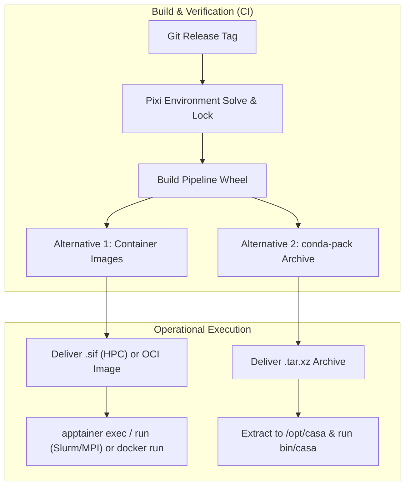

# Operational Deployment Strategies

> [!NOTE] Internal Memo / Proposal
> This document is a draft proposal evaluating operational deployment strategies for delivering modular CASA and the Science Data Processing Pipeline to operational cluster environments (ALMA, VLA).

---

## Overview

Historically, CASA and the Pipeline were distributed as an all-inclusive monolithic tarball (e.g. `casa-6.x-pipeline.tar.xz`, 2–3 GB compressed, 7–10 GB unpacked). While straightforward for standalone desktop users, the monolithic packaging model introduced specific failure modes on ALMA and VLA cluster infrastructure:

- **Shared Filesystem Inode & Metadata Contention**: Unpacking 50,000–80,000 files per monolithic release strains parallel shared storage (Lustre, NFS). When a Slurm batch job launches hundreds of parallel MPI workers simultaneously, thousands of concurrent `stat` and `open` operations storm the Lustre Metadata Server (MDS), causing I/O locking and startup delays.
- **Host OS and `glibc` Coupling**: Monolithic CASA binaries were compiled against a specific baseline (e.g. CentOS 7 / RHEL 8). Upgrading host operating systems or running across heterogenous cluster nodes frequently triggered ABI incompatibilities (`GLIBC_X.XX not found`).
- **Release and Dependency Rigidity**: The Pipeline was tightly coupled to the monolithic CASA build harness. Applying a single pipeline bug fix or updating a minor Python dependency required rebuilding and redistributing the entire multi-gigabyte bundle.
- **Air-Gapped Cluster Constraints**: Operational compute nodes operate with restricted or zero direct internet access, prohibiting runtime package resolution (`pip install`, `conda install`) during job execution.

To decouple development from operations, dependency resolution is isolated to CI using Pixi and locked manifests (`pixi.lock`). CI then produces pre-verified, standalone runtime deliverables for operational clusters:



---

## Alternative 1: Container Images (Apptainer / Singularity & Docker)

Alternative 1 packages the complete Linux runtime, modular CASA, locked dependencies, and the Pipeline package into a container image. To prevent recipe drift between Docker and Apptainer while supporting both environments, all provisioning and installation logic is centralized in a shared script:

- **`packaging/container/setup.sh`**: Single source of truth containing system packages, Pixi setup, locked dependency installation, wheel installation, and cache cleanup.
- **`packaging/apptainer/Apptainer.def`**: Thin wrapper for standalone Singularity Image Format (`.sif`) builds without requiring root privileges or a Docker daemon.
- **`packaging/docker/Dockerfile`**: Thin OCI recipe for building, testing, and publishing images using Docker or Podman.

### Advantages
- **Zero Recipe Drift**: All provisioning steps live in `setup.sh`; package, solver, or pip changes only need to be made once.
- **Single file on HPC (`.sif`)**: Eliminates metadata and inode contention on Lustre and NFS shared storage.
- **Daemonless HPC builds**: `Apptainer.def` builds directly on cluster login nodes without Docker daemon or root access.
- **Path-independent**: The image can be moved, renamed, or mirrored without breaking embedded paths.
- **Host OS independent**: Isolates glibc and system library differences across cluster nodes.
- **Native MPI support**: Apptainer directly integrates with host Slurm PMIX and InfiniBand drivers (`FI_PROVIDER=^psm3` suppresses Omni-Path provider probe failures on non-OmniPath fabrics).

### 1. Packaging Architecture

#### A. Shared Provisioning Script (`packaging/container/setup.sh`)

Single source of truth for all build-time installation steps:

```bash
#!/usr/bin/env bash
set -euo pipefail

# Suppress Python 3.12 syntax warnings from legacy CASA escape sequences
export PYTHONWARNINGS=ignore::SyntaxWarning

# 1. System packages
microdnf install -y tar gzip bzip2 libglvnd-glx
microdnf clean all

# 2. Install Pixi without telemetry
export PIXI_NO_TELEMETRY=1
curl -fsSL https://pixi.sh/install.sh | bash
export PATH=/root/.pixi/bin:$PATH

# 3. Install locked dependencies, pre-built wheel (with its runtime dependencies), and precompile bytecode
cd /app
pixi install --environment default --locked --skip pipeline --run-post-link-scripts
/app/.pixi/envs/default/bin/pip install --no-cache-dir --root-user-action=ignore \
    --extra-index-url https://casa-pip.nrao.edu/repository/pypi-group/simple \
    /app/dist/*.whl
/app/.pixi/envs/default/bin/python -m compileall -q -f -x 'contrib' /app || true

# 4. Strip build-time headers, static archives, and redundant files
rm -rf /app/dist
rm -rf /app/.pixi/envs/default/include
find /app/.pixi/envs/default -name "*.a" -delete
find /app/.pixi/envs/default/lib/python3.12/site-packages -type d -name "tests" -exec rm -rf {} + 2>/dev/null || true

# 5. Clean build, package manager, and download caches
pixi clean cache --yes
rm -rf /root/.cache /root/.pixi /var/cache/* /var/log/*
```

#### B. Apptainer Definition Recipe (`packaging/apptainer/Apptainer.def`)

Used for standalone Apptainer builds on HPC clusters without Docker:

```dockerfile
Bootstrap: docker
From: almalinux:9-minimal

%labels
    Maintainer NRAO Science Data Processing Pipeline
    Description CASA and Pipeline Operational Container

%files
    pyproject.toml /app/pyproject.toml
    pixi.lock /app/pixi.lock
    dist/*.whl /app/dist/
    packaging/container/setup.sh /app/setup.sh

%environment
    export LC_ALL=C.UTF-8
    export PYTHONNOUSERSITE=1
    export PYTHONWARNINGS=ignore::SyntaxWarning
    export OMP_PLACES=threads
    export OMP_PROC_BIND=false
    export OMP_NUM_THREADS=4
    export OPENBLAS_NUM_THREADS=4
    export FI_PROVIDER=^psm3
    export PATH=/app/.pixi/envs/default/bin:$PATH

%post
    bash /app/setup.sh
    rm -f /app/setup.sh

%runscript
    exec /app/.pixi/envs/default/bin/python -m casashell "$@"
```

#### C. Docker Recipe (`packaging/docker/Dockerfile`)

Used for building with Docker / Podman or cloud container registries:

```dockerfile
FROM almalinux:9-minimal

LABEL maintainer="NRAO Science Data Processing Pipeline" \
      description="CASA and Pipeline Operational Container"

# Environment configuration
ENV LC_ALL=C.UTF-8 \
    PYTHONNOUSERSITE=1 \
    PYTHONWARNINGS=ignore::SyntaxWarning \
    OMP_PLACES=threads \
    OMP_PROC_BIND=false \
    OMP_NUM_THREADS=4 \
    OPENBLAS_NUM_THREADS=4 \
    FI_PROVIDER=^psm3 \
    PATH=/app/.pixi/envs/default/bin:$PATH

WORKDIR /app

# Copy dependency manifests, pre-built wheel, and common provisioning script
COPY pyproject.toml pixi.lock /app/
COPY dist/*.whl /app/dist/
COPY packaging/container/setup.sh /app/setup.sh

# Run common installation script and cleanup
RUN bash /app/setup.sh && rm -f /app/setup.sh

ENTRYPOINT ["/app/.pixi/envs/default/bin/python", "-m", "casashell"]
```

### 2. Build Procedure in CI

Execute from the repository root:

```bash
# 1. Build release wheel into dist/
pixi run python -m build --wheel --no-isolation

# 2a. Standalone Apptainer SIF build (Default gzip compression):
apptainer build pipeline-2026.3.sif packaging/apptainer/Apptainer.def

# 2b. Standalone Apptainer SIF build (Optimized high compression, ~600-700 MB):
apptainer build --mksquashfs-args="-comp zstd -Xcompression-level 19 -b 1M" \
    pipeline-2026.3.sif packaging/apptainer/Apptainer.def

# 2c. Standalone Apptainer SIF build (Uncompressed, zero decompression overhead):
apptainer build --mksquashfs-args="-no-compression" \
    pipeline-2026.3.sif packaging/apptainer/Apptainer.def

# 2d. Or build with Docker / Podman:
docker build -f packaging/docker/Dockerfile -t pipeline:2026.3 .

# 2e. (Optional) Convert local Docker image to Apptainer SIF:
apptainer build pipeline-2026.3.sif docker-daemon://pipeline:2026.3
```

#### Image Sizing and Compression Trade-offs

Apptainer encapsulates the container filesystem within an internal SquashFS filesystem. The compression strategy should be chosen according to cluster constraints:

- **High Compression (`-comp zstd -Xcompression-level 19 -b 1M` or `-comp xz`)**:
  Reduces total SIF size from ~950 MB to ~600–700 MB by maximizing the block size (1 MB vs. default 128 KB) and using high-ratio compressors. Recommended when storing images on bandwidth-limited transfer paths or mirroring to remote sites.
- **Uncompressed (`-no-compression`)**:
  Disables SquashFS compression entirely. While the resulting image is larger (~2.5 GB), it eliminates CPU decompression overhead on compute nodes and minimizes read latency and lock contention when hundreds of parallel Slurm/MPI tasks concurrently open the container from shared storage (Lustre / GPFS).
- **In-Image Footprint Optimization**:
  `packaging/container/setup.sh` automatically strips build-time C/C++ header files (`include/`), static library archives (`*.a`), unneeded python `tests/` directories, and pip/rattler download caches to ensure neither dead code nor staging wheels are persisted into the container image.

### 3. Operational Execution

Transfer `pipeline-2026.3.sif` to operational shared storage (e.g. `/shared/containers/`).

At runtime, compute environments must bind-mount both the shared workspace storage (e.g. `/lustre`) and the site CASA runtime/measures data directory (e.g. `/home/casa/data/distro`). This keeps the container image lightweight and immutable while ensuring `casatools` can resolve external ephemerides and geodetic tables.

**Interactive or Serial Execution:**
```bash
apptainer run \
    --bind /lustre,/home/casa/data/distro \
    /shared/containers/pipeline-2026.3.sif --pipeline
```

**MPI Parallel Execution:**
```bash
# Using host OpenMPI:
mpirun -n 16 apptainer exec \
    --bind /lustre,/home/casa/data/distro \
    /shared/containers/pipeline-2026.3.sif \
    python -m casashell -c "import pipeline; ..."

# Or via native Slurm PMIx:
srun -n 16 apptainer exec \
    --bind /lustre,/home/casa/data/distro \
    /shared/containers/pipeline-2026.3.sif \
    python -m casashell -c "import pipeline; ..."
```

*(Note: If site runtime data is stored in a custom host directory, map it into the path expected by your site or user `config.py`, e.g. `--bind /lustre,/path/to/casarundata:/home/casa/data/distro:ro`)*.

---

## Alternative 2: Self-Unpacking Relocatable Tarball (`conda-pack`)

Alternative 2 creates a traditional compressed archive similar to legacy monolithic CASA releases. It bundles the installed Conda environment, third-party wheels, the pipeline package, and an automated startup wrapper.

### Advantages
- Requires no container runtime (Apptainer/Docker) on operational compute hosts.
- Preserves traditional filesystem workflows (`/opt/casa/...`).
- Auto-unpacking wrapper eliminates manual path-patching steps for operators.

### 1. Build and Packaging Script (`packaging/tarball/package_tarball.sh`)

The packaging script is located at `packaging/tarball/package_tarball.sh`. It can be run directly from the repository root:

```bash
./packaging/tarball/package_tarball.sh [VERSION]
```

Source implementation:

```bash
#!/usr/bin/env bash
set -euo pipefail

ENV_NAME="default"
VERSION="2026.3.0"
DIST_DIR="dist"
BUILD_DIR="build_tarball"

# 1. Build pipeline release wheel
python -m build --wheel --no-isolation

# 2. Instantiate clean environment with conda-pack
pixi install --environment "${ENV_NAME}" --locked
pixi add --pypi conda-pack --environment "${ENV_NAME}"

# 3. Install pipeline wheel into environment prefix
ENV_PATH=".pixi/envs/${ENV_NAME}"
"${ENV_PATH}/bin/pip" install --no-deps "${DIST_DIR}"/*.whl

# 4. Pack environment into temporary archive
mkdir -p "${BUILD_DIR}/root"
"${ENV_PATH}/bin/conda-pack" -p "${ENV_PATH}" -o "${BUILD_DIR}/env.tar.gz"

# 5. Extract to staging directory
tar -xzf "${BUILD_DIR}/env.tar.gz" -C "${BUILD_DIR}/root"
rm -f "${BUILD_DIR}/env.tar.gz"

# 6. Inject relocatable wrapper launcher
cat <<'EOF' > "${BUILD_DIR}/root/bin/casa"
#!/usr/bin/env bash
# Dynamically locate the environment root, wherever this directory is moved
ENV_DIR="$(cd "$(dirname "${BASH_SOURCE[0]}")/.." && pwd)"

# One-time path relocation fix on initial run (if conda-unpack is present)
if [ -f "${ENV_DIR}/bin/conda-unpack" ]; then
    "${ENV_DIR}/bin/conda-unpack" 2>/dev/null || true
    rm -f "${ENV_DIR}/bin/conda-unpack"
fi

# Environment safety invariants
export PYTHONNOUSERSITE=1
export OMP_PLACES="threads"
export OMP_PROC_BIND="false"
export OMP_NUM_THREADS="${OMP_NUM_THREADS:-4}"
export OPENBLAS_NUM_THREADS="${OPENBLAS_NUM_THREADS:-4}"
export FI_PROVIDER="${FI_PROVIDER:-^psm3}"

# Prepend environment bin to PATH for subprocesses and MPI utilities
export PATH="${ENV_DIR}/bin:${PATH}"

# Launch casashell directly via python binary (bypasses broken script shebangs)
exec "${ENV_DIR}/bin/python" -m casashell "$@"
EOF
chmod +x "${BUILD_DIR}/root/bin/casa"

# 7. Compress into final distribution archive
FINAL_ARCHIVE="${PROJECT_ROOT}/casa-pipeline-${VERSION}-linux-x86_64.tar.xz"
tar -cf - -C "${BUILD_DIR}/root" . | xz -T0 -3 > "${FINAL_ARCHIVE}"
rm -rf "${BUILD_DIR}"

echo "[SUCCESS] Built operational archive: ${FINAL_ARCHIVE}"
```

### 2. Operational Deployment and Execution

Operations receives `casa-pipeline-2026.3.0-linux-x86_64.tar.xz`.

1. **Extract into the target directory:**
   ```bash
   mkdir -p /opt/casa/pipeline-2026.3
   tar -xf casa-pipeline-2026.3.0-linux-x86_64.tar.xz -C /opt/casa/pipeline-2026.3
   ```

2. **Execute directly:**
   ```bash
   /opt/casa/pipeline-2026.3/bin/casa --pipeline
   ```

### 3. Relocation Mechanics & Directory Moves

Standard Conda environments hardcode the installation prefix into CLI script shebang lines (`#!/.../bin/python`). If an unpacked environment is subsequently moved (`mv` or `cp`), those static shebangs point to stale paths. 

The bundled `bin/casa` launcher resolves this by adopting the traditional monolithic CASA execution pattern:

- **Bypassing Shebangs:** The launcher computes `ENV_DIR="$(cd "$(dirname "${BASH_SOURCE[0]}")/.." && pwd)"` dynamically at runtime and invokes `exec "${ENV_DIR}/bin/python" -m casashell "$@"`. Because the Python interpreter is called directly, the operating system never reads or evaluates script shebang lines.
- **Dynamic Python Prefix Detection:** Python automatically sets `sys.prefix` based on the location of its own binary on disk. It locates standard libraries and installed packages (`site-packages`) relative to `${ENV_DIR}` regardless of where the folder has been moved.
- **Relative Dynamic Library Runpaths:** Shared C/C++ libraries in `conda-forge` packages are compiled with relative runpaths (`RPATH=$ORIGIN/../lib`). The dynamic linker resolves runtime dependencies relative to the executable path rather than absolute system directories.
- **Subprocess Isolation:** Prepending `${ENV_DIR}/bin` to `PATH` ensures child processes and MPI workers resolve the bundled runtime tools without requiring manual environment activation.

#### Recommended Symlink Pattern for Upgrades
For production operations, unpack releases into version-tagged directories and use a symbolic link for job execution:
```bash
# 1. Unpack release
tar -xf casa-pipeline-2026.3.0.tar.xz -C /opt/casa/releases/2026.3.0/

# 2. Update operational pointer
ln -sfn /opt/casa/releases/2026.3.0 /opt/casa/pipeline-current
```
Batch scripts reference `/opt/casa/pipeline-current/bin/casa`. Upgrades or rollbacks only require updating the symlink pointer.

---

## Technical Comparison

| Consideration | Monolithic CASA (Legacy) | Alternative 1: Apptainer SIF (Recommended) | Alternative 2: Tarball (`conda-pack`) |
| :--- | :--- | :--- | :--- |
| **Deliverable** | Single `.tar.xz` (~2.5 GB) | Single `.sif` file (~600–950 MB) | Single `.tar.xz` file (~1.2 GB) |
| **Filesystem Footprint** | ~70,000 files / inodes | **1 inode** (SquashFS loop device) | ~35,000 files / inodes |
| **Lustre MDS Load at Startup**| Severe contention | **Negligible** | Moderate |
| **Host System Dependencies** | Exact matching OS/glibc baseline | **Linux kernel $\ge 4.18$ + Apptainer** | System `tar`, `xz`, host `glibc $\ge 2.28$` |
| **Host Privilege Escalation** | None | **None** (unprivileged user namespaces) | None |
| **Cluster MPI / Slurm** | Bundled OpenMPI | **Host OpenMPI or Slurm PMIx pass-through** | Bundled OpenMPI |
| **Operator Workflow Changes** | None (baseline) | Minimal (add `apptainer run --bind ...`) | Zero (identical CLI interface) |

---

## Trade-offs and Considerations

### 1. Shared Filesystem Scalability
- **Monolithic & conda-pack**: Every execution causes the dynamic linker (`ld.so`) and Python interpreter to traverse shared directories, resolving hundreds of `.so` and `.py` files. On Lustre filesystems running parallel batch jobs, concurrent imports across hundreds of compute cores create high lock contention on the Metadata Target (MDT).
- **Apptainer SIF**: The entire directory tree is encapsulated inside a read-only SquashFS block device. The host kernel mounts the image via loopback, localizing directory lookups and file metadata operations to the compute node's page cache.

### 2. Host Operating System and Runtime Boundaries
- **Monolithic & conda-pack**: Binaries execute directly against the host Linux environment and C runtime (`libc.so.6`). An archive built on a newer distribution cannot run on a cluster node with an older `glibc` version.
- **Apptainer SIF**: Isolates the complete user space (AlmaLinux 9 minimal) from the host distribution. The host needs only a compatible Linux kernel (version 4.18+, standard on RHEL 8/9 and modern distributions) with unprivileged user namespace support enabled.

### 3. External Measures Data Management
None of the alternative models bundle CASA runtime data (IERS Bulletin-A, leap seconds, solar system ephemerides) inside the executable artifact. Because measures tables update regularly, bundling them inside a container image would invalidate the artifact's immutability and require frequent multi-gigabyte rebuilds. Operational clusters must maintain an external measures mirror (e.g. `/home/casa/data/distro`) and expose it to the runtime:
- **Apptainer**: Explicitly bind-mounted via `--bind /lustre,/home/casa/data/distro`.
- **conda-pack**: Configured via `~/.casa/config.py` (`measurespath` / `rundata`) or `CASADATA` environment variable.

### 4. Patch Turnaround & In-Place Code Editing
- **Monolithic & conda-pack**: Extracted files remain directly accessible in the filesystem. Developers or operators can inspect or hot-patch a Python file directly inside `site-packages` to test a fix without running a full packaging cycle.
- **Apptainer SIF**: The image is an immutable SquashFS filesystem. In-place file edits are impossible without rebuilding the `.sif` file, or overlaying the local package via bind mount (`-B /path/to/pipeline:/app/.pixi/envs/default/lib/python3.12/site-packages/pipeline`).
