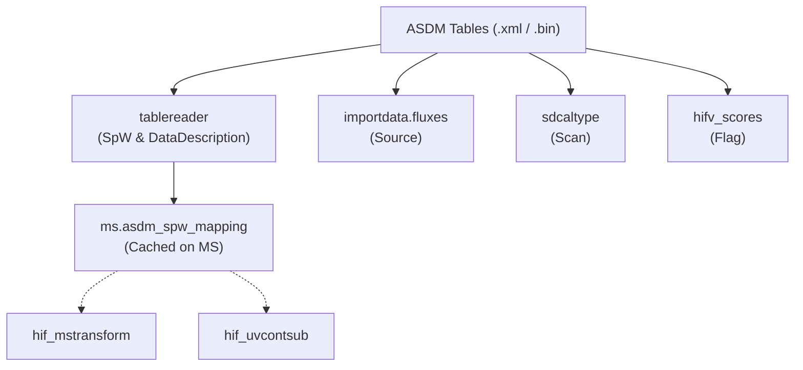

# ASDM Metadata Parsing and `pyasdm` (PIPE-3268)

> **Related Tickets**: {jira}`PIPE-3268` (pyasdm integration), {jira}`PIPE-2576` (online flag interval fix)

*AI Disclosure: This technical reference was drafted with AI assistance and reviewed by pipeline developers against the codebase. If any inaccuracies are identified, please report or submit corrections through the standard development workflow (e.g., via a Jira issue or documentation pull request).*

The Pipeline relies on ASDM metadata for several operations during calibration and QA, including
mapping ASDM Spectral Window IDs to MeasurementSet SpW IDs, reading calibrator flux densities,
evaluating scan intents for single-dish heuristics, and checking online flags.

Historically, this metadata was extracted using ad-hoc XML string parsing (`xml.etree.cElementTree`)
or `xml.dom.minidom`. Starting with {jira}`PIPE-3268`, the pipeline uses [`pyasdm`](https://github.com/casangi/pyasdm)
to access ASDM tables directly through its Python API.

---

## Design and Pipeline Touchpoints

ASDM tables are accessed via `pyasdm` across four main areas in the pipeline:

### 1. ASDM to MS SpW ID Mapping (`pipeline.infrastructure.tablereader`)
CASA's `importasdm` does not always preserve ASDM Spectral Window ordering when creating the MS SPW table.
The pipeline therefore builds a mapping from ASDM `SpectralWindowId` to MS SpW ID by cross-referencing
the `SpectralWindow` and `DataDescription` tables:

* `SpectralWindowTable.get_asdm_to_ms_spw_mapping(ms)` reads the tables and computes the lookup dictionary.
* Both `.xml` and binary `.bin` table files are checked in `candidate_dirs` (`ms.name` and fallback `ms.origin_ms`).
* If `pyasdm` fails (for example, on partial XML test snippets lacking `<ContainerEntity>`), the code falls back
  to `xml.etree.ElementTree`.
* The computed dictionary is cached directly on the `ms` domain object as `ms.asdm_spw_mapping`.

### 2. SpW Mapping Propagation (`mstransform` and `uvcontsub`)
Derived MeasurementSets created by `mstransform` or `uvcontsub` often do not carry along local copies of
ASDM tables in their directory.

To prevent tasks from failing or trying to re-read missing disk tables, `mstransform.analyse()` and
`uvcontsub.analyse()` pass `ms.origin_ms` and the pre-computed `ms.asdm_spw_mapping` forward to newly
registered child MS instances. Subsequent SpW lookups on derived MSes hit memory directly (~0.1 µs).

### 3. Calibrator Flux Density Ingestion (`pipeline.h.tasks.importdata.fluxes`)
`read_fluxes_nodb(ms)` extracts flux densities from `Source.xml` / `Source.bin`:

* Uses `pyasdm.SourceTable` to access typed `row.getFrequency()` and `row.getFlux()` getters.
* Converts frequency values into `measures.Frequency` (Hz) and Stokes flux values into `measures.FluxDensity` (Jy)
  tuples directly using `.get()`, eliminating manual string whitespace splitting and 1D-to-2D index offset arithmetic.
* Falls back to the legacy string parser if `pyasdm` cannot parse the table.

### 4. Single-Dish Scan Intent Heuristics (`pipeline.hsd.heuristics.sdcaltype`)
`AsdmCalibrationTypeHeuristics` inspects scan intents in `Scan.xml` to classify observing modes
(e.g., raster vs. point-and-shoot):

* Uses `pyasdm.ScanTable` to iterate over scans and check `row.getScanIntent()`.
* Replaced `xml.dom.minidom.parse()`, which previously built a full DOM tree in memory and had a known
  history of leaking memory on large execution blocks with tens of thousands of scans.

### 5. Online Flag Validation (`pipeline.qa.hifv_scores`)
`_has_zero_endtime_online_flags(ms)` inspects `Flag.xml` / `Flag.bin` to check for unclosed or corrupted
intervals in VLA online flags:

* Uses `pyasdm.FlagTable` and evaluates `row.getEndTime().get() == 0`.
* Corrects the earlier string check (`row.findtext('endTime') == '0'`), which could evaluate incorrectly
  depending on whitespace or interval representations.

---

## Trade-offs and Considerations

### Why Use `pyasdm`
* **Binary MIME table support**: ASDM tables that grow large in operations (e.g. `Flag`, high-channel `SpectralWindow`)
  are often packaged as binary MIME (`.bin`) parts. Standard XML parsers cannot read binary ASDM tables; `pyasdm`
  supports both transparently.
* **Safer data types**: Avoids brittle string splitting on whitespace and manual array indexing. Quantities,
  enums, and array shapes are validated according to the official ASDM data model.
* **No `minidom` leaks**: Streamed row iteration avoids DOM tree memory issues in long pipeline runs.

### Caveats and Mitigations
* **External dependency**: Adds `pyasdm>=0.0.7` to `pyproject.toml` and `pixi.lock`.
* **Cold parse time**: Pure-Python XML parsing in `pyasdm` takes ~40–100 ms per table compared to ~2–3 ms
  for C-based `ElementTree`. However, because tables are parsed only once during import (total overhead < 0.15s)
  and cached in memory thereafter, the macro-level impact on pipeline runtime is imperceptible.
* **Schema header strictness**: `pyasdm` expects complete ASDM table structures with root container entities.
  For legacy mock XML fragments in unit tests that lack these headers, touchpoints retain fallbacks to `ElementTree`.

---

## Guidelines for Developers

* **Use `pyasdm` table access**: When reading ASDM tables, prefer `pyasdm.ASDM()` rather than introducing
  new XML string parsers.
* **Check for both extensions**: Look for `{table}.xml` and `{table}.bin` in candidate directories.
* **Use `ms.origin_ms`**: For transformed or split MSes, look up metadata in `ms.origin_ms`.
* **Cache on domain objects**: Do not re-parse ASDM tables inside per-spw or per-field loops; store computed
  results on the `MeasurementSet` object.
