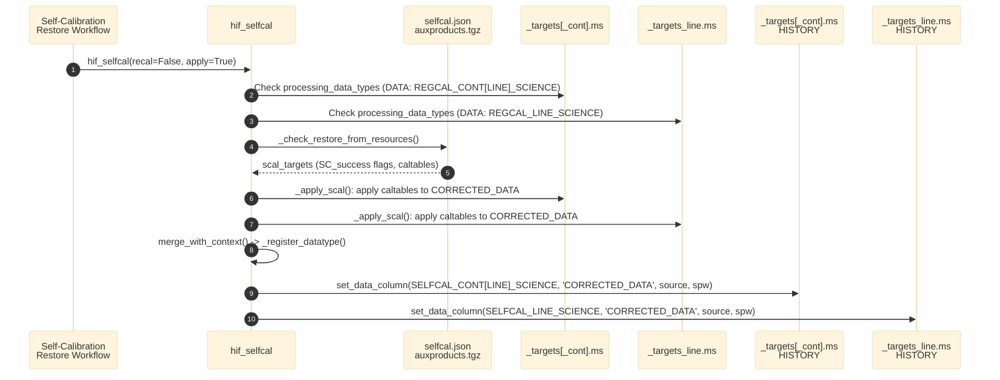

# DataType Design

This document describes how pipeline data types ({class}`~pipeline.domain.DataType`) are represented, updated, persisted, and queried across the pipeline workflow lifecycle.

Originally, the pipeline assumed visibility data lived either in `'DATA'` (for raw data) or `'CORRECTED_DATA'` (for calibrated data). With the addition of science target splitting (`_targets.ms`), continuum subtraction (`_targets_line.ms`), and self-calibration ({func}`~pipeline.hif.cli.hif_selfcal`), visibilities in `'DATA'` or `'CORRECTED_DATA'` can represent different data states in various reduction stages. The `DataType` design tracks these calibration states so that downstream tasks (such as {func}`~pipeline.hif.cli.hif_makeimlist`) can automatically select the appropriate columns and datasets per field and spectral window without hardcoding column information or explicit task input instructions.

---

## Visibility Data Types

Visibility types are defined by the {class}`~pipeline.domain.DataType` enum in {mod}`pipeline.domain`:

* `RAW`: Uncalibrated visibility data.
* `REGCAL_CONTLINE_ALL`: Standard-calibrated data containing both continuum and lines for all targets and calibrators.
* `ATMCORR`: Offline atmospheric-corrected data (Single Dish).
* `BASELINED`: Baseline-subtracted data (Single Dish).
* `REGCAL_CONTLINE_SCIENCE`: Standard-calibrated data for science targets (continuum + line).
* `SELFCAL_CONTLINE_SCIENCE`: Self-calibrated data for science targets (continuum + line).
* `IM_CONTLINE_SCIENCE`: Transformed/re-gridded science data for continuum+line imaging.
* `REGCAL_CONT_SCIENCE`: Standard-calibrated continuum-only science data.
* `SELFCAL_CONT_SCIENCE`: Self-calibrated continuum-only science data.
* `IM_CONT_SCIENCE`: Transformed/re-gridded science data for continuum imaging.
* `REGCAL_LINE_SCIENCE`: Standard-calibrated, continuum-subtracted line data.
* `SELFCAL_LINE_SCIENCE`: Self-calibrated, continuum-subtracted line data.
* `IM_LINE_SCIENCE`: Transformed/re-gridded science data for spectral line imaging.

### In-Memory Representation (`MeasurementSet`)

Each {class}`~pipeline.domain.MeasurementSet` domain object tracks datatype state via two attributes:

1. **`ms.data_column: dict[DataType, str]`**  
   Global mapping from `DataType` to column name (`'DATA'` or `'CORRECTED_DATA'`).
2. **`ms.data_types_per_source_and_spw: dict[tuple[str, int], list[DataType]]`**  
   Per-(source, spw) mapping from `(source_name, real_spw_id)` to the data types present in that MS (at most two: one for `'DATA'` and one for `'CORRECTED_DATA'`). Keys use real spw IDs; for multi-EB runs with virtual spws, the translation between virtual and real spw IDs is handled by `ObservingRun` query methods.

These dictionaries are managed through:

* {meth}`~pipeline.domain.MeasurementSet.set_data_column`
* {meth}`~pipeline.domain.MeasurementSet.get_data_column`
* {meth}`~pipeline.domain.MeasurementSet.get_data_type`

### On-Disk Persistence (MS `HISTORY` Table)

Starting in **v2025.1.0** ({jira}`PIPE-2432`), whenever {meth}`~pipeline.domain.MeasurementSet.set_data_column` is called with `save_to_ms=True` (the default), the pipeline persists both dictionaries into the MS `HISTORY` subtable under `origin="Datatype Handler"`:

```text
data_type_per_column = {'RAW': 'DATA', ...}
data_types_per_source_and_spw = {('FIELD_A', 0): ['RAW'], ...}
```

### Inspecting DataType from an Existing MS

You can inspect the persisted datatypes directly from Python using pipeline heuristics without loading a full pipeline context:

```python
from pipeline.infrastructure import tablereader
from pipeline.h.heuristics.importdata import get_ms_data_types_from_history

ms_path = "uid___A002_Xc3412f_X2a7d_targets_line.ms"
history_entries = tablereader.MeasurementSetReader.get_history(ms_path)
data_type_per_column, data_types_per_source_spw = get_ms_data_types_from_history(history_entries)
```

Example output from a split line MS where self-calibration succeeded on spw 23 of target `G5.89-0.39`:

```python
# data_type_per_column
{<DataType.REGCAL_LINE_SCIENCE: 11>: 'DATA',
 <DataType.SELFCAL_LINE_SCIENCE: 12>: 'CORRECTED_DATA'}

# data_types_per_source_spw
{('G5.89-0.39', 22): [<DataType.REGCAL_LINE_SCIENCE: 11>],
 ('G5.89-0.39', 23): [<DataType.REGCAL_LINE_SCIENCE: 11>,
                      <DataType.SELFCAL_LINE_SCIENCE: 12>],
 ('G5.89-0.39', 24): [<DataType.REGCAL_LINE_SCIENCE: 11>]}
 ...
```

---

## Lifecycle across Standard Reduction Workflows

The diagram below outlines when datatype information is assigned and propagated through a typical ALMA / VLA interferometry run:

```mermaid
%%{init: {
  "theme": "base",
  "elk": {"lineHops": false}
}}%%
flowchart TD
    subgraph ALMA ["ALMA Data Workflow"]
        direction LR
        A1["Raw Ingestion<br><code>hifa_importdata</code>"] -->|"DATA:<BR>RAW"| B1["Calibration<br><code>hif_applycal</code>"]
        B1 -->|"CORRECTED_DATA:<br>REGCAL_CONTLINE_ALL"| C1["Target Splitting<br><code>hif_mstransform</code>"]
        
        %% Single data node for the split target MS; consumers fan out from it
        C1 --> T1["_targets.ms<br>DATA: REGCAL_CONTLINE_SCIENCE"]

        %% Finding cont.dat and line extraction
        T1 --> FC1["Cont. Finding<br><code>hif_findcont</code>"]
        FC1 --> CD1[("cont.dat<br>Line-free ranges")]
        
        T1 --> UVC1["Cont. Subtraction<br><code>hif_uvcontsub</code>"]
        CD1 -.->|"Fit ranges"| UVC1
        UVC1 -->TL1["_targets_line.ms DATA:<br>REGCAL_LINE_SCIENCE"]
        
        %% Standard Cont. Imaging
        T1 --> IMG1_CONT["Standard Cont. Imaging<br><code>hif_makeimages (cont)</code>"]
        CD1 -.->|"Channel selection"| IMG1_CONT
        
        %% Self-Calibration & Selfcal Imaging
        T1 --> SC1["Self-Calibration<br><code>hif_selfcal</code>:solve"]
        CD1 -.->|"Flag lines before solve"| SC1
        SC1 --> |"<code>hif_selfcal</code>:apply"| SC_DATA1["_targets.ms CORRECTED_DATA:<br>SELFCAL_CONTLINE_SCIENCE<br><br>_targets_line.ms CORRECTED_DATA:<br>SELFCAL_LINE_SCIENCE"]
        TL1 -->|"<code>hif_selfcal</code>:apply"| SC_DATA1
        SC_DATA1 --> IMG1_SC["Selfcal/Standard Imaging<br><code>hif_makeimages (datatype='best')</code>"]
    end

    subgraph VLA ["VLA Data Workflow"]
        direction LR
        A2["Raw Ingestion<br><code>hifv_importdata</code>"] -->|"DATA:<BR>RAW"| B2["Calibration<br><code>hifv_applycals</code>"]
        B2 -->|"CORRECTED_DATA:<br>REGCAL_CONTLINE_ALL"| C2["Dual Target Split<br><code>hifv_mstransform</code>"]
        
        %% Data nodes for the two split MSs; consumers fan out from them
        C2 --> T2["_targets.ms<br>DATA: REGCAL_CONTLINE_SCIENCE<BR>without RFI flagging"]
        C2 --> TC2["_targets_cont.ms<br>DATA: REGCAL_CONT_SCIENCE<BR>with RFI flagging"]

        %% Finding cont.dat and line extraction
        T2 --> FC2["Cont. Finding<br><code>hif_findcont</code>"]
        FC2 --> CD2[("cont.dat<br>Line-free ranges")]
        
        T2 --> UVC2["Cont. Subtraction<br><code>hif_uvcontsub</code>"]
        CD2 -.->|"Fit ranges"| UVC2
        UVC2 -->TL2["_targets_line.ms DATA: REGCAL_LINE_SCIENCE"]

        TL2 --> IMG2_LINE["Standard Cube Imaging<br><code>hif_makeimages (cube)</code>"]
        
        %% Standard Cont. Imaging
        TC2 --> IMG2_CONT["Standard Cont. Imaging<br><code>hif_makeimages (cont)</code>"]
        
        %% Self-Calibration & Selfcal Imaging
        TC2 --> SC2["Self-Calibration<br><code>hif_selfcal</code>:solve"]
        CD2 -.->|"Flag lines before solve"| SC2
        SC2 --> |"<code>hif_selfcal</code>:apply"| SC_DATA2["_targets_cont.ms CORRECTED_DATA:<br>SELFCAL_CONT_SCIENCE<br><br>_targets_line.ms CORRECTED_DATA:<br>SELFCAL_LINE_SCIENCE"]
        TL2 -->|"<code>hif_selfcal</code>:apply"| SC_DATA2
        SC_DATA2 --> IMG2_SC["Selfcal Imaging<br><code>hif_makeimages (datatype='selfcal')</code>"]
    end

    %% Data nodes styled like the edge labels: grey fill, no border
    classDef datalabel fill:#e8e8e8,color:#333
    class T1,TL1,T2,TL2,TC2 datalabel

    %% Data nodes styled like the edge labels: grey fill, no border
    classDef dataupdate fill:#e8e8e8,stroke-width:0px,color:#333
    class SC_DATA1,SC_DATA2 dataupdate

    ALMA ~~~ VLA
```



### Stage Details

1. **`h*_importdata` ({func}`~pipeline.hifa.cli.hifa_importdata`, {func}`~pipeline.hifv.cli.hifv_importdata`, {func}`~pipeline.hsd.cli.hsd_importdata`)**:
   * Reads MS `HISTORY` via {func}`~pipeline.h.heuristics.importdata.get_ms_data_types_from_history`.
   * If entries are found (e.g. importing a pre-existing target MS), they are restored into `ms.data_column` and `ms.data_types_per_source_and_spw`.
   * If the user provided the `datacolumns` parameter, user-specified types override history.
   * If no history exists (e.g., standard ASDM import), defaults to:
     * `'DATA' -> DataType.RAW`
     * `'CORRECTED' -> DataType.REGCAL_CONTLINE_ALL` (if `CORRECTED_DATA` column exists).
2. **`h*_applycal` ({func}`~pipeline.hif.cli.hif_applycal`, {func}`~pipeline.hifv.cli.hifv_applycals`)**:
   * After caltables are applied, `ApplycalResults.merge_with_context()` sets `DataType.REGCAL_CONTLINE_ALL` on `'CORRECTED_DATA'`.
3. **`mssplit` / `transformimagedata`**:
   * When splitting target fields (`intent='TARGET'`), sets `'DATA'` of the new MS to `DataType.REGCAL_CONTLINE_SCIENCE`.
4. **`h*_mstransform` ({func}`~pipeline.hif.cli.hif_mstransform`, {func}`~pipeline.hifv.cli.hifv_mstransform`)**:
   * Maps parent datatypes to transformed target types (`REGCAL_CONTLINE_SCIENCE -> IM_CONTLINE_SCIENCE`, `SELFCAL_CONTLINE_SCIENCE -> IM_CONTLINE_SCIENCE`).
   * For VLA, registers `DataType.REGCAL_CONT_SCIENCE` on `_targets.ms` and `DataType.REGCAL_CONTLINE_SCIENCE` on `_targets_line.ms`.
5. **`hif*_selfcal` ({func}`~pipeline.hif.cli.hif_selfcal`, {func}`~pipeline.hifv.cli.hifv_selfcal`)**:
   * When self-cal solutions are applied, maps the base `'DATA'` type to its selfcal equivalent (`REGCAL_* -> SELFCAL_*`).
   * Calls {meth}`~pipeline.domain.MeasurementSet.set_data_column` with `(dtype_applied, 'CORRECTED_DATA', source=field, spw=spw_sel)` for each successfully calibrated target and SPW.
6. **{func}`~pipeline.hif.cli.hif_uvcontsub`**:
   * Sets `'DATA'` of `_targets_line.ms` to `DataType.REGCAL_LINE_SCIENCE`.
7. **Single Dish ({func}`~pipeline.hsd.cli.hsd_atmcor`, {func}`~pipeline.hsd.cli.hsd_baseline`)**:
   * Sets `'DATA'` to `DataType.ATMCORR` after atmospheric correction, and `DataType.BASELINED` after baseline subtraction.

---

## Restore Workflows & Self-Calibration

### Standard Restore ({func}`~pipeline.hifa.cli.hifa_restoredata` / {func}`~pipeline.hifv.cli.hifv_restoredata`)

When running standard restore tasks:

1. The import task class ({class}`~pipeline.hifa.tasks.importdata.almaimportdata.ALMAImportData` for ALMA, or {class}`~pipeline.hifv.tasks.importdata.importdata.VLAImportData` for VLA) is called directly as a subtask, setting `'DATA'` to `DataType.RAW` and writing the initial history record.
2. Caltables and flags are unpacked and restored.
3. {class}`~pipeline.hif.tasks.applycal.ifapplycal.IFApplycal` or {class}`~pipeline.hifv.tasks.finalcals.applycals.Applycals` applies calibrations, generating `CORRECTED_DATA`, and registers `DataType.REGCAL_CONTLINE_ALL`, writing a second record to MS `HISTORY`.

> **Note on `restoredata` Scope & Target Splitting**:  
> {func}`~pipeline.hifa.cli.hifa_restoredata` / {func}`~pipeline.hifv.cli.hifv_restoredata` only restores the parent EB (`<uid>.ms`) with standard-calibrated data in `CORRECTED_DATA`. It does not split science targets or apply self-calibration, so restored parent EBs will never contain `SELFCAL_*` datatypes.  
> Consequently, workflows must explicitly run {func}`~pipeline.hif.cli.hif_mstransform` (ALMA) or {func}`~pipeline.hifv.cli.hifv_mstransform` (VLA) between standard restore and self-calibration restore. Self-calibration restoration operates directly on the split target MeasurementSets (`_targets.ms`), not on the parent EB (see below).

### Follow-up Self-Calibration Restore (`hif_selfcal` Apply-Only Mode)

To restore self-calibrated data, a workflow must run {func}`~pipeline.hif.cli.hif_mstransform` / {func}`~pipeline.hifv.cli.hifv_mstransform` to generate `_targets.ms`, followed by {func}`~pipeline.hif.cli.hif_selfcal` in restore mode (`recal=False`, `apply=True`):



1. **Target MS Input**: `hif_selfcal` operates on `_targets.ms`, verifying `'DATA'` is registered as `DataType.REGCAL_CONTLINE_SCIENCE` or `DataType.REGCAL_CONT_SCIENCE` (matching `SelfcalInputs.processing_data_types`).
2. **Solution Discovery**: `hif_selfcal` checks for `selfcal.json` in the current working directory, in `../products/`, or inside `auxproducts.tgz`. If found, it sideloads the solutions and skips the self-cal solver.
3. **Selective Application**: For each target where self-calibration succeeded (`SC_success == True`), caltables are applied to `CORRECTED_DATA` in `_targets.ms` (and `_targets_line.ms` if present). Unsuccessful targets retain standard-calibrated data in `CORRECTED_DATA` (from the initialization of the `CORRECTED_DATA` column).
4. **Datatype Registration**: In the `merge_with_context()` class method, `_register_datatype()` registers `DataType.SELFCAL_*` on `CORRECTED_DATA` scoped strictly to the successful field and SPW combinations.
5. **Target MS Persistence**: In ≥ PL2025, {meth}`~pipeline.domain.MeasurementSet.set_data_column` writes the updated dictionaries to the `HISTORY` table of the **split target MS** (`_targets.ms`).

---

## Where DataType Info Gets Used Downstream

### 1. Automatic Dataset Scope Resolution ({class}`~pipeline.infrastructure.vdp.StandardInputs`)

When a pipeline task executes without an explicit `vis` argument, {class}`~pipeline.infrastructure.vdp.StandardInputs` inspects the task's `Inputs.processing_data_types`:

```python
ms_pool = context.observing_run.get_measurement_sets_of_type(processing_data_types)
```

This ensures imaging tasks automatically process `_targets.ms` or `_targets_line.ms` rather than raw parent EBs without needing hardcoded paths.

### 2. Imaging Column & Fallback Selection (`MakeImList` / `EditImList`)

In {func}`~pipeline.hif.cli.hif_makeimlist` and {func}`~pipeline.hif.cli.hif_editimlist`:

1. `DataType.get_specmode_datatypes(intent, specmode)` defines candidate types in fallback order:
   * **Science targets** (e.g. continuum):  
     `[IM_CONTLINE_SCIENCE, SELFCAL_CONTLINE_SCIENCE, REGCAL_CONTLINE_SCIENCE, REGCAL_CONTLINE_ALL, RAW]`  
     Selfcal data is preferred over regcal. If science targets have not been split to `_targets.ms` yet, it falls back to `REGCAL_CONTLINE_ALL` in the parent MS, and down to `RAW` if uncalibrated.
   * **Calibrators**:  
     `[REGCAL_CONTLINE_ALL, RAW]`
2. For each target and virtual spw, the pipeline queries:

   ```python
   observing_run.get_measurement_sets_of_type(dtypes=specmode_datatypes, source=field, spw=spw, vis=vislist)
   ```

   This translates virtual spw to real spw per MS and checks {meth}`~pipeline.domain.MeasurementSet.get_data_column`. If selfcal data exists for that (field, real spw), imaging reads `CORRECTED_DATA` (`SELFCAL_*`); otherwise it falls back to `DATA` (`REGCAL_*`).
3. The selected data type is recorded in `CleanTarget['datatype']` (with any fallback notes in `CleanTarget['datatype_info']`) and displayed in the WebLog.

### 3. Image Product Filenames and Headers

* **Filenames**: {class}`~pipeline.hif.tasks.editimlist.Editimlist` derives `datatype_suffix` (`'selfcal'` or `'regcal'`) based on the clean target's datatype, which `pipeline.infrastructure.filenamer` inserts into the FITS and CASA image names.
* **Headers**: `pipeline.infrastructure.imageheader` records the datatype string in image metadata.

### 4. WebLog & QA Handling

* **WebLog**: Imaging templates render badges (`RAW`, `REGCAL`, `SELFCAL`, `IMAGING`) via `DataType.get_short_datatype_desc()` and group diagnostic plots accordingly.
* **QA Scoring**: In `pipeline.h.tasks.importdata.qa`, `HISTORY` table checks explicitly ignore entries where `origin="Datatype Handler"` so that persisted datatype records do not generate spurious QA warnings.

---

## Version Compatibility & Caveats

```{list-table}
:header-rows: 1
:widths: 22 24 24 30

* - Pipeline Version
  - {func}`~pipeline.hif.cli.hif_selfcal` Available
  - Datatypes in MS `HISTORY`
  - Method to Check Self-Cal Success
* - **≥ PL2025 (v2025.1.0+)**
  - Yes
  - **Yes**
  - MS `HISTORY` or `selfcal.json`
* - **PL2023 / PL2024**
  - Yes (introduced v2023.1.0)
  - **No** (in-memory context only)
  - `selfcal.json` (or `auxproducts.tgz` caltables)
* - **≤ PL2022**
  - No
  - **No**
  - N/A
```

### Important Practical Caveats

1. **Older Pipeline Runs Have No Datatypes in MS HISTORY**:  
   Because MS `HISTORY` persistence was added in PL2025 ({jira}`PIPE-2432`), datasets processed with or restored under PL2023 or PL2024 will return empty results from `get_ms_data_types_from_history()`.
2. **Reliable Determination of Self-Calibration Status**:  
   If checking whether self-calibration succeeded across arbitrary versions (e.g. in archiving or verification scripts), inspect `selfcal.json` (checking `sc_lib['SC_success']`) rather than assuming MS `HISTORY` is populated. This matches the method used internally by {func}`~pipeline.hif.cli.hif_selfcal` during apply-only restore.

### Related JIRA Tickets

* {jira}`PIPE-2432`: Initial persistence of datatype dictionaries to MS `HISTORY` table (`save_to_ms=True`).
* {jira}`PIPE-2492`: Saved target-phase calibrator scan metadata in `_targets.ms` history table for mosaic self-calibration.
* {jira}`PIPE-2500`: Added `recal=True` support to recalculate selfcal on data already marked with `DataType`.
* {jira}`PIPE-2555`: Handled off-tree MS writes, added `nocopy=True` support, switched history parsing to `ast.literal_eval()`, and added unit tests.

---

## Testing / Mocking DataType Setups

To test downstream tasks like `hif_makeimlist` or `hif_editimlist` without running full self-calibration, one can mock `set_data_column` calls directly on imported target MSes.

> **Prerequisite**: If the imported target MS does not yet contain a `CORRECTED_DATA` column, ensure one exists (e.g. by copying `DATA` to `CORRECTED_DATA` via CASA `tb` tool) before registering data types on `'CORRECTED_DATA'`. Otherwise `set_data_column` will raise a `ValueError`.

For example, taking two target MSes from a multi-EB run:

```python
from pipeline.domain import DataType

ctx = h_init()
hifa_importdata(
    ['uid___A002_Xed4607_Xfbf7_targets.ms', 'uid___A002_Xed4607_Xfd64_targets.ms'],
    datacolumns={'data': 'regcal_contline_science'}
)

# MS 1 (real spws 13, 15, 17, 19): set selfcal on spws 17 and 19 in CORRECTED_DATA
ctx.observing_run.measurement_sets[0].set_data_column(
    DataType.SELFCAL_CONTLINE_SCIENCE, 'CORRECTED_DATA', source='HL_Tau', spw='17'
)
ctx.observing_run.measurement_sets[0].set_data_column(
    DataType.SELFCAL_CONTLINE_SCIENCE, 'CORRECTED_DATA', source='HL_Tau', spw='19'
)

# MS 2 (real spws 5, 7, 9, 11): set selfcal on spws 7, 9, 11
ctx.observing_run.measurement_sets[1].set_data_column(
    DataType.SELFCAL_CONTLINE_SCIENCE, 'CORRECTED_DATA', source='HL_Tau', spw='7'
)
ctx.observing_run.measurement_sets[1].set_data_column(
    DataType.SELFCAL_CONTLINE_SCIENCE, 'CORRECTED_DATA', source='HL_Tau', spw='9'
)
ctx.observing_run.measurement_sets[1].set_data_column(
    DataType.SELFCAL_CONTLINE_SCIENCE, 'CORRECTED_DATA', source='HL_Tau', spw='11'
)

h_save('c1')
```

This sets up mixed calibration states across virtual spws:
* Virtual spw 13: regcal only.
* Virtual spw 15: selfcal in MS 2 (real spw 7), regcal in MS 1 (real spw 15).
* Virtual spws 17 and 19: selfcal in both MSes.

From here, you can resume `c1` and run imaging stages to verify that the expected column and data types are picked up per field and spw.
