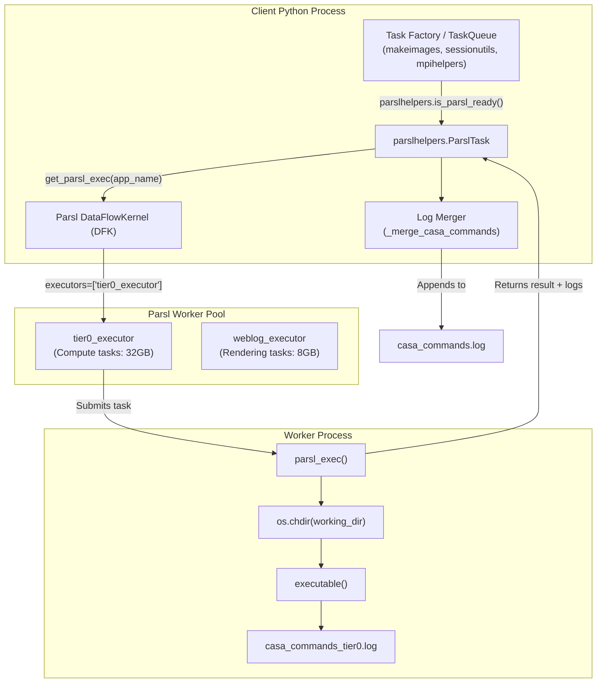
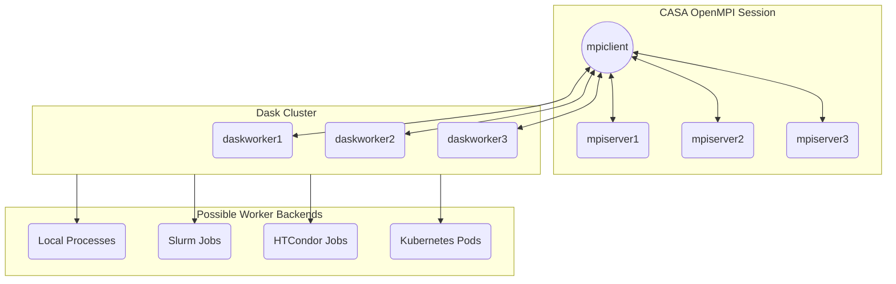
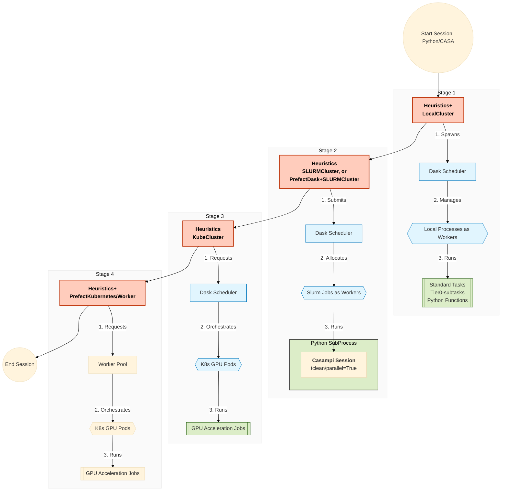

# Parallelization

* [pipeline/infrastructure/mpihelpers.py](https://open-bitbucket.nrao.edu/projects/PIPE/repos/pipeline/browse/pipeline/infrastructure/mpihelpers.py) - This module contains the original `casampi`-based wrapper layer. It is used to dispatch {doc}`pipeline tasks <../../apisummary>`, casatasks [jobrequest](https://open-bitbucket.nrao.edu/projects/PIPE/repos/pipeline/browse/pipeline/infrastructure/jobrequest.py), or any pickleable Python functions through `casampi` on the preallocated MPI cluster spawned from a `mpicasa` session.

* [pipeline/infrastructure/daskhelpers.py](https://open-bitbucket.nrao.edu/projects/PIPE/repos/pipeline/browse/pipeline/infrastructure/daskhelpers.py) - This module contains helper functions, including the logic for sanitizing MPI environment variables to prevent conflicts when running Dask workers within an active MPI session. It also includes utilities for creating and configuring Dask clusters with different backends (local, Slurm, HTCondor, Kubernetes) and for handling the lifecycle of the cluster in the context of the pipeline. It provides a Dask-based mechanism to dispatch pipeline tasks, casatasks `jobrequest`, or pickleable Python functions, serving as an alternative to the `casampi`-based approach in `mpihelpers.py`.

* [pipeline/infrastructure/parslhelpers.py](https://open-bitbucket.nrao.edu/projects/PIPE/repos/pipeline/browse/pipeline/infrastructure/parslhelpers.py) - This module provides the Parsl adaptation layer for pipeline task dispatch. It checks DataFlowKernel readiness, routes Tier0 executables to targeted executors (such as `tier0_executor`), handles working directory restoration for remote batch workers, and merges worker CASA command logs back into the client session.

* [pipeline/config.yaml](https://open-bitbucket.nrao.edu/projects/PIPE/repos/pipeline/browse/pipeline/config.yaml) - The default configuration file where Dask cluster settings are defined, including parameters for different cluster types, default worker counts, and job names. A hierarchical structure configuration setup is implemented (`workdir/config.yaml`->`~/.casa/config.yaml`->`pipeline/config.yaml`) to allow for flexible overrides at different levels of the user environment. This is the current setup for Dask cluster parameters.

## Parsl Adaptation Layer

The Parsl adaptation layer (`pipeline.infrastructure.parslhelpers`) enables the CASA pipeline to dispatch parallel Tier0 workloads—such as calibrator imaging (`tclean`), RMS map generation (`imdev`), and batched plot generation (`plotms`)—to workers managed by Parsl.

### Design and Touchpoints

The pipeline uses an abstract `Executable` pattern to decouple heuristics from the underlying execution engine. When Parsl is loaded and active, task factories encapsulate work in a `Tier0Executable` and pass it to `parslhelpers.ParslTask`.



Key touchpoints across the pipeline architecture:
- `is_parsl_ready()`: Evaluates `parsl.dfk()` existence and ensures `dfk.cleanup_called` is false.
- `get_parsl_exec(app_name)`: Cached via `_PARSL_APPS` keyed by `(id(dfk), app_name)`. Dynamically targets `tier0_executor` when present in the DFK, falling back to `'all'` for single-pool clusters.
- `ParslTask`: Wraps task submission to Parsl, capturing the current working directory (`os.getcwd()`), awaiting results on `.get_result()`, and triggering `_merge_casa_commands`.
- `TaskQueue` & `CleanTaskFactory`: Prioritizes dispatch order as `Parsl` -> `Dask` -> `MPI` -> `Serial`.

### Trade-offs and Considerations

- **Multi-pool Resource Matching**: Unlike MPI (which uses a uniform pool of pre-spawned ranks), Parsl allows concurrent heterogeneous pools (e.g. `tier0_executor` with large memory for tclean vs `weblog_executor` for rendering). Explicit executor targeting ensures high-memory tasks do not starve or crash lightweight worker pods.
- **Worker Execution Context**: Batch schedulers (such as HTCondor) execute jobs within transient scratch directories. Workers explicitly change directories back to the project root (`working_dir`) upon invocation to allow relative file paths to MeasurementSets and calibration tables to resolve.
- **Log Isolation and Merging**: Each worker produces its own slice of CASA command logs. The client process reconciles `casa_commands_tier0.log` into the main `casa_commands.log` upon task completion, maintaining linear command histories.
- **Process Isolation vs. Thread Safety**: CASA C++ extensions are not thread-safe. Parsl execution must always utilize multiprocessing or process-isolated providers (such as `HighThroughputExecutor`) rather than `ThreadPoolExecutor`.

### Guidelines for Developers

- **Precedence Order**: When implementing new parallel task factories, always check backends in standard precedence order:
  ```python
  if parallel_wanted and parslhelpers.is_parsl_ready():
      return parslhelpers.ParslTask(executable)
  elif parallel_wanted and daskhelpers.is_dask_ready():
      return daskhelpers.FutureTask(executable)
  elif parallel_wanted and mpihelpers.is_mpi_ready():
      return mpihelpers.AsyncTask(executable)
  else:
      return mpihelpers.SyncTask(sync_call, executor)
  ```
- **Direct Function Invocation**: Call `parslhelpers.is_parsl_ready()` directly. Do not wrap with defensive `getattr(..., lambda: False)` checks.
- **State Serialization**: Ensure all task parameters encapsulated in `Tier0Executable` are picklable by standard Python pickle. Context state must be saved to `.context` temporary files rather than serialized wholesale over RPC.

## Future improvement - Potential Parallelization Paradigm for Pipeline processing

## version 1

* with traditional `mpicasa` configuration, no nested subprocess, dask clusters spawned from the mpi client process
* mpi cluster is still a fixed resource allocation.



## version 2

* parallelization/workflow/graphreduction handled by Dask and workflow orchestration library,
* with nested subprocess for casampi / tclean(parallel=True) if absolutely necessary when no alternative solution exists, such as [CASA memo#13](https://casadocs.readthedocs.io/en/stable/notebooks/memo-series.html).
* data processing session reaches out to workload manager / resource manager for surged resource allocation, instead of fixed resource allocation at the start of the session.
* persisted new context design with adaptation layer to support existing pipeline framework and new parallelization/workflow paradigm.


