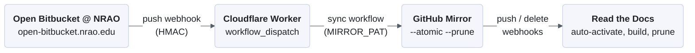

# Building & Publishing Documentation

This page describes how Pipeline documentation is built locally and automatically published to [Read the Docs][rtd]. The pipeline documentation is organized into three main groups: **User Reference** (guides, task manual, releases), **Developer Notes** (internal documentation like this page), and **Code Examples** (practical use cases).

[rtd]: https://about.readthedocs.com

## Building Docs Locally

Use the Pixi `docs` environment to build documentation locally. For detailed task descriptions and options, see the [Pixi Workflow guide](pixi_tasks.md#documentation-building).

```console
# Full HTML build (runs all notebooks)
pixi run -e docs build-docs

# Fast HTML build (skips notebook re-execution)
pixi run -e docs build-docs-fast

# PDF build
pixi run -e docs build-pdfs
```

HTML output is written to `docs/_build/html/`. Open `docs/_build/html/index.html` in a browser to preview.

### PDF (LaTeX) Prerequisites

Building PDF documentation locally (`pixi run -e docs build-pdfs`) requires system LaTeX packages:

- **Ubuntu/Debian:** Install [TeX Live](https://www.tug.org/texlive/) packages:

  ```console
  sudo apt-get install -y latexmk texlive-latex-recommended texlive-latex-extra texlive-fonts-recommended
  ```

- **macOS:** Install [MacTeX](https://www.tug.org/mactex/) via Homebrew:

  ```console
  brew install --cask mactex-no-gui
  ```

### Building the Internal Variant

The documentation includes an internal variant containing developer notes and architecture docs. To build it locally, set `BUILD_INTERNAL_DOCS=1`:

```console
# Build internal variant into default _build/html
BUILD_INTERNAL_DOCS=1 pixi run -e docs build-docs-fast

# Or build into a separate directory
BUILD_INTERNAL_DOCS=1 pixi run -e docs make -C docs html_fast BUILDDIR=_build_internal
```

## Contribution & Review Workflow

Documentation source files live alongside the code in `pipeline/docs/`, and we generally encourage heuristic updates and documentation changes to be reviewed and merged in the same pull request.

1. **Branch**: Create `PIPE-XXXX-description` from `main` (for the next cycle), from `release/*` (for code backports), or from `docs/YYYY.M.m` (for doc-only updates to a published release).
2. **Build locally**:

   ```console
   pixi run -e docs build-docs-fast
   BUILD_INTERNAL_DOCS=1 pixi run -e docs build-docs-fast
   ```

3. **Push & preview**: Push your branch to [Open Bitbucket @ NRAO](https://open-bitbucket.nrao.edu/projects/PIPE/repos/pipeline). A Bitbucket webhook triggers the GitHub mirror and Read the Docs build automatically (see [Read the Docs Hosting & CI Pipeline](#read-the-docs-hosting--ci-pipeline) for details). Check build status in the [Read the Docs dashboard](https://app.readthedocs.org/projects/pipe-docs/builds/).
4. **Open PR**: Add the RTD preview link to the Bitbucket PR description for reviewers.

(viewing-branch-builds-on-read-the-docs)=
(previewing-branch-builds)=

### Previewing Branch Builds

Branch builds are activated automatically once mirrored and can be viewed directly by slug:

- **Public docs**: `https://pipe-docs.readthedocs.io/en/<version-slug>/`
- **Internal docs**: `https://pipe-docs.readthedocs.io/en/<version-slug>/internal/`

Read the Docs lowercases branch names and converts slashes and underscores to hyphens (e.g., `PIPE-3268-use-pyasdm-for-metadata-parsing-in-pipeline` becomes `pipe-3268-use-pyasdm-for-metadata-parsing-in-pipeline`).

## Branching Strategy & Version Mapping

Our Read the Docs setup maps repository branches and tags to versions following these conventions:

```{list-table}
:header-rows: 1
:widths: 22 14 50 14

* - Git Ref
  - RTD Version
  - Description
  - Flyout Visibility
* - `main`
  - `latest`
  - Active development (unreleased changes)
  - Visible
* - `stable` (tag)
  - `stable`
  - Current operational release (default landing page)
  - Visible (Default)
* - `docs/YYYY.M.m`
  - `vYYYY.M.m`
  - Release or post-release documentation maintenance (e.g., `v2026.2.1`) for adding latest information like [known issues](../../users_guide/known_issues.md)
  - Visible
* - Other branches (e.g., `PIPE-XXXX-*`)
  - `<branch-slug>`
  - Feature, bugfix, and other non-`main`/`docs/20*` branches (auto-activated on push, removed when deleted)
  - Hidden
```

## Read the Docs Hosting & CI Pipeline

Source code is hosted on [Open Bitbucket @ NRAO](https://open-bitbucket.nrao.edu/projects/PIPE/repos/pipeline) (our public on-premises Bitbucket Data Center instance), while [Read the Docs][rtd] builds from the GitHub mirror:



1. **Bitbucket to GitHub mirror**: Bitbucket `repo:refs_changed` webhooks hit a Cloudflare Worker relay, which triggers `.github/workflows/sync-from-open-bitbucket.yml` via `workflow_dispatch`. The workflow fetches all branches and tags (`refs/heads/*`, `refs/tags/*`) from Bitbucket and pushes them to GitHub with `--atomic --prune`, causing GitHub to emit `push` and `delete` webhook events. A 2-hour `cron` schedule serves as a fallback if a webhook is missed.
2. **Read the Docs automation**: Three RTD Automation Rules manage branch versions, and active branches rebuild automatically on each mirrored push:
   - **Activate version** (`Branch`, `Any`): activates every newly pushed branch.
   - **Hide version** (`Branch`, `^(?!main$|docs/20).*$`): hides branches other than `main` and `docs/20*` from the flyout menu while keeping them accessible via direct URL.
   - **Delete version** (`Branch`, `Any`): removes the RTD version when the branch is pruned from GitHub.
3. **Build execution**: Builds follow `.readthedocs.yaml`:
   - Check out repository branch
   - Install system packages (`texlive`, `imagemagick`, `poppler-utils`)
   - Install [Pixi](https://pixi.sh) and the `docs` environment
   - Run Sphinx builds via Pixi tasks for HTML and PDF, including a second pass with `BUILD_INTERNAL_DOCS=1` for the `/internal/` subsite

Hosted docs: [pipe-docs.readthedocs.io](https://pipe-docs.readthedocs.io/)

- **Build history**: <https://app.readthedocs.org/projects/pipe-docs/builds/>
- **Version settings**: <https://app.readthedocs.org/projects/pipe-docs/versions/>

## Design Choices

### API Documentation

For API documentation, we support two Sphinx approaches:

- **Namespace-based**: `sphinx.ext.autodoc` with `autosummary`
- **Module-based**: `automodapi` extension

Both are customized using Jinja + RST templates and local Python code for careful namespace management and cross-module imports.

### Notebooks and MyST-NB

[MyST-NB][myst-nb] is used over nbsphinx for broader feature support, active maintenance, and flexibility with both `.ipynb` notebooks and MyST-enhanced Markdown files.

### Math, Diagrams & Citations

Author-facing rendering extensions configured in `docs/source/conf.py` include:

- **Math (`sphinx.ext.mathjax`)**: Renders LaTeX equations via MathJax in HTML and natively in LaTeX PDF builds.
- **Diagrams (`sphinxcontrib.mermaid`, `sphinx.ext.graphviz`, `sphinx.ext.imgconverter`)**: Supports ` ```mermaid ` fences and Graphviz/inheritance diagrams, with ImageMagick conversion for PDF output.
- **Citations (`sphinxcontrib.bibtex`, `sphinx_astrorefs`)**: Supports BibTeX references and astronomy journal macros.

[myst-nb]: https://myst-nb.readthedocs.io/en/latest/
