# What's New in Pipeline 2026.2.0

This document summarizes ALMA Pipeline development on the
[`PIPE/pipeline`](https://open-bitbucket.nrao.edu/projects/PIPE/repos/pipeline/browse)
repository between October 2025 and August 2026, targeting release
**2026.2.0**.

---

## Highlights

- **{func}`hif_findroi <pipeline.hif.cli.hif_findroi>`: a new fast region-of-interest stage.** A new imaging
  stage, {func}`hif_findroi <pipeline.hif.cli.hif_findroi>`, identifies
  likely source regions ahead of continuum/line imaging using a fast
  algorithm developed under PIPEREQ-414, and has been wired into the ALMA
  imaging recipes. See {ref}`IF imaging heuristics <hif_findroi>`.
- **Imaging moves to an LSRK-frame MS ahead of continuum/line separation.**
  {func}`hif_mstransform <pipeline.hif.cli.hif_mstransform>` now produces the
  measurement sets used for imaging in the LSRK frame, and
  {func}`hif_uvcontsub <pipeline.hif.cli.hif_uvcontsub>` /
  {func}`hif_makeimlist <pipeline.hif.cli.hif_makeimlist>` /
  {func}`hif_makeimages <pipeline.hif.cli.hif_makeimages>` were updated to
  consume the new frame and data types. See
  {ref}`IF imaging heuristics <lsrk-refactor>`.
- **`findContinuum` updated to v9.6** with a round of robustness and
  parameter-passing fixes (`uvrange` propagation, empty-baseline crash
  guards, y-axis limits) — see {ref}`IF imaging heuristics <findcontinuum>`.
- **QA-message aggregation rolled out across most SD stages** so that
  repeated warnings for the same metric/score collapse into a single
  accordion entry in the weblog, matching the IF weblog style — see
  {ref}`SD weblog/QA <sd-weblog-qa>`.
- **Low-SNR bandpass/gain heuristics extended** to {func}`hif_lowgainflag <pipeline.hif.cli.hif_lowgainflag>` and
  {func}`hifa_wvrgcalflag <pipeline.hifa.cli.hifa_wvrgcalflag>`, reusing the `combine='spw'` + `interp='linearPD'`
  low-SNR machinery introduced for PL2025 — see
  {ref}`IF calibration heuristics <if-calibration>`.
- **Several QA-score thresholds were re-tuned** (percent-flagged,
  newly-flagged, check-source fit, RepBW mom8fc) based on an analysis of
  "slow lane" false positives, aiming to route more good data through the
  ALMA FastLane — see {ref}`IF weblog/QA <if-weblog-qa>`.
- **Single-dish imaging switches from `pseudoI` to true Stokes I** imaging,
  simplifying the weight-handling pipeline — see
  {ref}`SD heuristics <sd-heuristics>`.
- **Documentation restructuring**: CLI docstrings extracted from the User
  Guide, a new getting-started guide, and a live dependency specification —
  see {ref}`Documentation <documentation>`.

---

(if-calibration)=
## IF calibration heuristic changes

*(not weblog or QA — see {ref}`IF weblog/QA <if-weblog-qa>` for score/plot changes
to these same tasks)*

**Low-SNR bandpass/gain heuristics extended to more stages.**
The `combine='spw'` + `interp='linearPD'` low-SNR bandpass/phase-up
heuristic developed for PL2025 was extended across more of the calibration
recipe: {func}`hif_lowgainflag <pipeline.hif.cli.hif_lowgainflag>` now
reuses the ALMA phase-up bandpass code from
{func}`hifa_bandpass <pipeline.hifa.cli.hifa_bandpass>` instead of a generic
worker; the `interp='linearPD'` rule was generalized to every stage that can
trigger a `combine='spw'` solve for CHECK/PHASE intents
({func}`hifa_bandpassflag <pipeline.hifa.cli.hifa_bandpassflag>`,
{func}`hifa_bandpass <pipeline.hifa.cli.hifa_bandpass>`,
{func}`hifa_gfluxscale <pipeline.hifa.cli.hifa_gfluxscale>`,
{func}`hifa_diffgaincal <pipeline.hifa.cli.hifa_diffgaincal>`,
{func}`hifa_timegaincal <pipeline.hifa.cli.hifa_timegaincal>`); and
{func}`hifa_wvrgcalflag <pipeline.hifa.cli.hifa_wvrgcalflag>` gained the same
per-spw low-SNR fallback instead of crashing when a gain table ends up fully
flagged. A regression introduced along the way — a phase-offset solve step
dropped ahead of the new phase-up, which had worsened flagging for a clear
low-SNR case — was subsequently corrected.
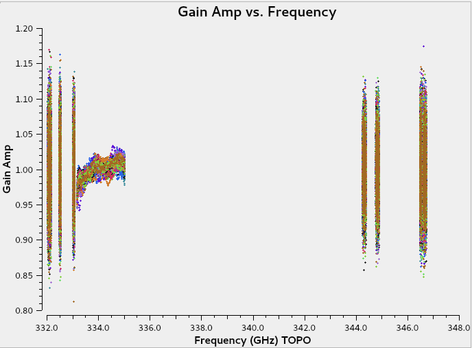
*Tickets: [PIPE-2601](https://open-jira.nrao.edu/browse/PIPE-2601),
[PIPE-2858](https://open-jira.nrao.edu/browse/PIPE-2858),
[PIPE-3006](https://open-jira.nrao.edu/browse/PIPE-3006),
[PIPE-3139](https://open-jira.nrao.edu/browse/PIPE-3139).*

**Polarization calibration recipe fix.**
[PIPE-3016](https://open-jira.nrao.edu/browse/PIPE-3016) unregisters the
first spw-spw phase-offset table after the initial round of the
polarization-calibration recipe, so the second
{func}`hifa_bandpass <pipeline.hifa.cli.hifa_bandpass>` call (after
{func}`hifa_lock_refant <pipeline.hifa.cli.hifa_lock_refant>`) no longer pre-applies a now-stale table computed with a
possibly different reference antenna.
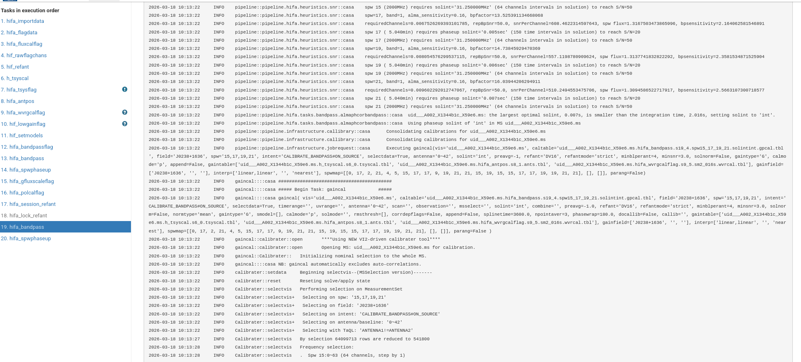

**Cross-pol examination for polarization/flux calibrators.**
[PIPE-2956](https://open-jira.nrao.edu/browse/PIPE-2956) adds an
`examineCrossPolSum` parameter to
{func}`hifa_polcalflag <pipeline.hifa.cli.hifa_polcalflag>` and
{func}`hifa_gfluxscaleflag <pipeline.hifa.cli.hifa_gfluxscaleflag>` (via
`correctedampflag`) to control whether cross-polarization data are examined
for multi-scan calibrators — a Band 2 dataset showed the original
same-scan-only assumption from PIPE-607 was too simplistic.
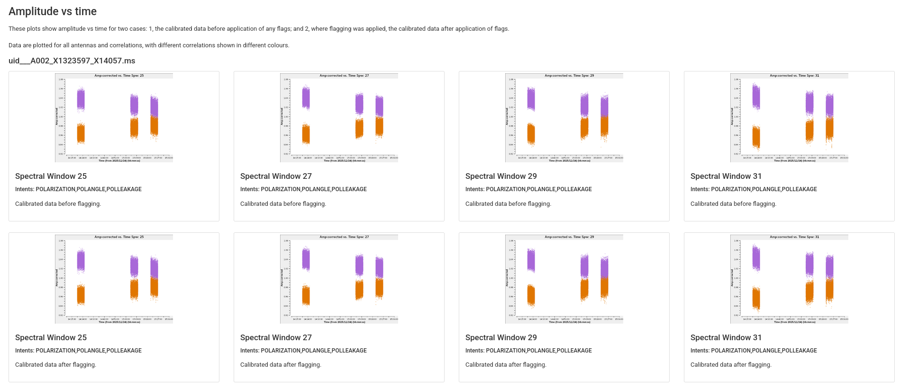

**Robustness fixes.**
[PIPE-2752](https://open-jira.nrao.edu/browse/PIPE-2752) refines heuristics
across {func}`h_tsyscal <pipeline.h.cli.h_tsyscal>`, {func}`hif_applycal <pipeline.hif.cli.hif_applycal>`, {func}`hifa_gfluxscale <pipeline.hifa.cli.hifa_gfluxscale>`,
{func}`hifa_gfluxscaleflag <pipeline.hifa.cli.hifa_gfluxscaleflag>`, {func}`hifa_importdata <pipeline.hifa.cli.hifa_importdata>`, {func}`hifa_spwphaseup <pipeline.hifa.cli.hifa_spwphaseup>` and
{func}`hifa_timegaincal <pipeline.hifa.cli.hifa_timegaincal>` that previously assumed a TARGET intent is always
present, improving support for calibration-only/calsurvey MS processing.
[PIPE-2694](https://open-jira.nrao.edu/browse/PIPE-2694) fixes an undefined
QA score (`min() arg is an empty sequence`) in
{func}`hifa_gfluxscale <pipeline.hifa.cli.hifa_gfluxscale>` for
band-to-band data without a CHECK intent.
[PIPE-2868](https://open-jira.nrao.edu/browse/PIPE-2868) adds an opt-in
bypass mode so {func}`hifa_antpos <pipeline.hifa.cli.hifa_antpos>` can
continue (with a bad QA score and warnings) instead of crashing when the
antenna-position query fails.
[PIPE-2166](https://open-jira.nrao.edu/browse/PIPE-2166) evaluates switching
{func}`visstat <casatasks.information.visstat>` to `doquantiles=False`
inside {func}`hifa_polcal <pipeline.hifa.cli.hifa_polcal>` for a runtime improvement, where the statistics used
allow it.
{func}`hifa_diffgaincal <pipeline.hifa.cli.hifa_diffgaincal>` no longer
crashes or over-flags TARGET/CHECK solutions when one of the two
band-to-band offset scan groups ends up fully flagged.
*Tickets: [PIPE-2915](https://open-jira.nrao.edu/browse/PIPE-2915),
[PIPE-2932](https://open-jira.nrao.edu/browse/PIPE-2932).*

**Import/data-handling fixes.**
[PIPE-3002](https://open-jira.nrao.edu/browse/PIPE-3002) fixes an
{func}`hifa_importdata <pipeline.hifa.cli.hifa_importdata>` weblog rendering failure when a polarization-calibrator
field selected for the parallactic-angle plot is present in one EB of a
session but not another.
[PIPE-3099](https://open-jira.nrao.edu/browse/PIPE-3099) fixes an MPI race
condition where concurrent {func}`hifa_importdata <pipeline.hifa.cli.hifa_importdata>` worker processes could read a
partially-flushed `flux.csv`, corrupting the import.
[PIPE-3101](https://open-jira.nrao.edu/browse/PIPE-3101) refactors the
Source-Catalog flux XML parser to be robust against schema changes rather
than relying on fixed field ordering.
[PIPE-2320](https://open-jira.nrao.edu/browse/PIPE-2320) fixes the
{func}`hifa_flagdata <pipeline.hifa.cli.hifa_flagdata>` FDM-spw detection
heuristic to use `msmd.almaspws()` instead of a channel-count threshold that
misclassified some Cycle 10 4×4-bit-correlation spws as TDM.
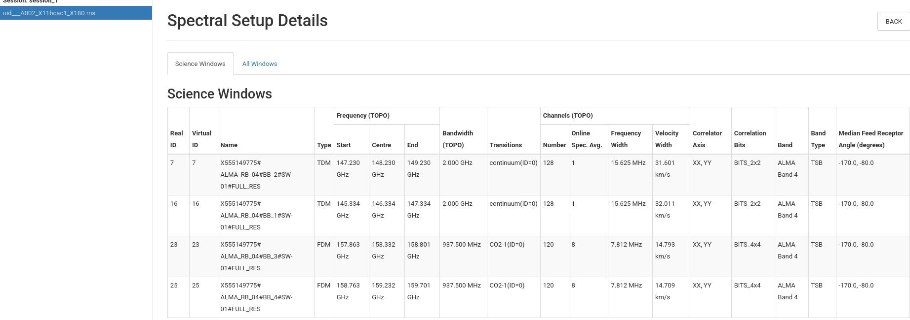
{func}`hifa_tsysflagcontamination <pipeline.hifa.cli.hifa_tsysflagcontamination>`
crashes were fixed for two independent causes: a NaN-handling incompatibility
with newer scipy `savgol_filter` versions, and a regex that assumed
measurement set names always start with `uid`.
*Tickets: [PIPE-2947](https://open-jira.nrao.edu/browse/PIPE-2947),
[PIPE-3115](https://open-jira.nrao.edu/browse/PIPE-3115).*

**Performance.**
[PIPE-3085](https://open-jira.nrao.edu/browse/PIPE-3085) reduces redundant
`ms.open()`/`ms.close()` calls in {func}`hifa_fluxcalflag <pipeline.hifa.cli.hifa_fluxcalflag>`'s frequency-frame
conversion and in {func}`hif_applycal <pipeline.hif.cli.hif_applycal>` weblog rendering, which was reopening the
MS once per field × spw × EB.

---

(if-imaging)=
## IF imaging heuristic changes

*(not weblog or QA)*

(hif_findroi)=
**{func}`hif_findroi <pipeline.hif.cli.hif_findroi>`: a new region-of-interest stage.**
A new imaging stage, `hif_findroi`, implements a fast region-of-interest
identification routine researched under PIPEREQ-414 and has been added to
the ALMA imaging recipes. Follow-up work improved its weblog view, fixed
field phase-center extraction lost in a merge conflict, fixed band-to-band
and polarization-calibration failures, added its output tarball to the
auxiliary export products, hid absolute filesystem paths that were leaking
into exported pickles, and reviewed the knock-on recipe-template changes.
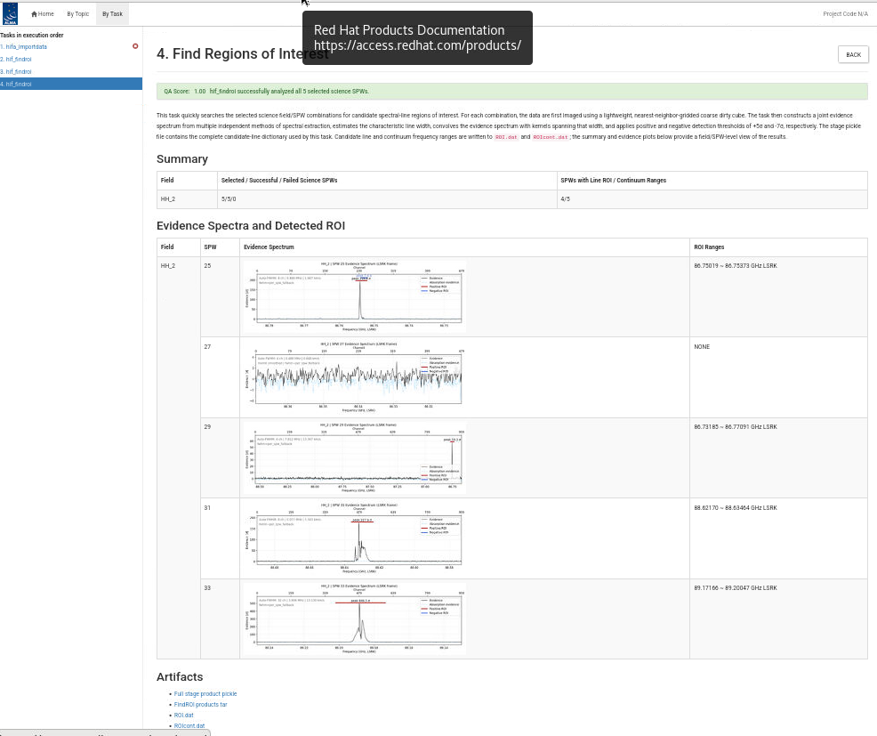
*Tickets: [PIPE-3149](https://open-jira.nrao.edu/browse/PIPE-3149),
[PIPE-3151](https://open-jira.nrao.edu/browse/PIPE-3151),
[PIPE-3150](https://open-jira.nrao.edu/browse/PIPE-3150),
[PIPE-3155](https://open-jira.nrao.edu/browse/PIPE-3155),
[PIPE-3162](https://open-jira.nrao.edu/browse/PIPE-3162),
[PIPE-3136](https://open-jira.nrao.edu/browse/PIPE-3136),
[PIPE-3191](https://open-jira.nrao.edu/browse/PIPE-3191),
[PIPE-3156](https://open-jira.nrao.edu/browse/PIPE-3156).*

(lsrk-refactor)=
**LSRK-frame imaging MS refactor.**
The new imaging workflow was reworked end-to-end around an LSRK-frame
imaging measurement set:
{func}`hif_mstransform <pipeline.hif.cli.hif_mstransform>` now produces the
MS used for imaging (`REGCAL_CONTLINE_SCIENCE` / `IM_CONTLINE_SCIENCE` /
`IM_LINE_SCIENCE` data types) already regridded to the **LSRK** frame,
rather than leaving that to individual imaging stages;
{func}`hif_uvcontsub <pipeline.hif.cli.hif_uvcontsub>`, which previously
assumed a fixed TOPO-MS / LSRK-or-SOURCE-`cont.dat` combination, was updated
to work correctly against the new LSRK-frame MS; and
{func}`hif_makeimlist <pipeline.hif.cli.hif_makeimlist>` /
{func}`hif_makeimages <pipeline.hif.cli.hif_makeimages>` were updated to
accept the new data types, falling back to the legacy
`targets`/`targets_line` MS when the new ones aren't present. A related
multi-day `hif_uvcontsub` slowdown seen during VLA restores (when product
mitigation had limited continuum finding to a handful of fields) was also
fixed; a parallel per-spw split for `hif_mstransform` was explored and
declined.
*Tickets: [PIPE-3003](https://open-jira.nrao.edu/browse/PIPE-3003),
[PIPE-3057](https://open-jira.nrao.edu/browse/PIPE-3057),
[PIPE-3053](https://open-jira.nrao.edu/browse/PIPE-3053),
[PIPE-2952](https://open-jira.nrao.edu/browse/PIPE-2952),
[PIPE-2955](https://open-jira.nrao.edu/browse/PIPE-2955).*

(findcontinuum)=
**`findContinuum` improvements (v9.6).**
`findContinuum.py` was updated to v9.6 under the PL2026 continuum-detection
umbrella ticket. End result:
{func}`hif_findcont <pipeline.hif.cli.hif_findcont>` now honors a `uvrange`
set by a prior {func}`hif_makeimlist <pipeline.hif.cli.hif_makeimlist>`
(previously dropped); it calls `hif_makeimlist` intrinsically instead of
depending on recipe task ordering, gaining a `coarse`/`normal` mode switch
that — after user feedback — defaults to `'normal'` (matching pre-refactor
behavior); it exposes a `field` parameter for the AUDI/VUDI workflow; two
crashes on edge cases with very few baseline channels
(`nanmedian`/`np.min` on an empty channel selection) were fixed; the
automatic y-axis limits were revisited so bright/maser lines don't leave
excessive white space in the continuum-fit plot; and a stray unclosed file
handle was closed.
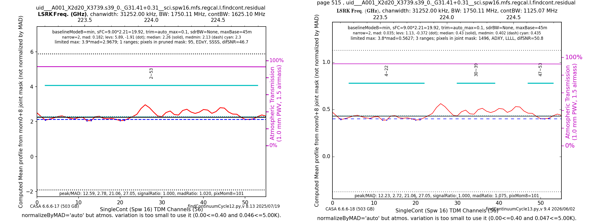
*Tickets: [PIPE-2766](https://open-jira.nrao.edu/browse/PIPE-2766),
[PIPE-2617](https://open-jira.nrao.edu/browse/PIPE-2617),
[PIPE-3131](https://open-jira.nrao.edu/browse/PIPE-3131),
[PIPE-3209](https://open-jira.nrao.edu/browse/PIPE-3209),
[PIPE-3164](https://open-jira.nrao.edu/browse/PIPE-3164),
[PIPE-3103](https://open-jira.nrao.edu/browse/PIPE-3103),
[PIPE-3107](https://open-jira.nrao.edu/browse/PIPE-3107),
[PIPE-850](https://open-jira.nrao.edu/browse/PIPE-850),
[PIPE-3102](https://open-jira.nrao.edu/browse/PIPE-3102).*

**Selfcal fixes.**
[PIPE-2908](https://open-jira.nrao.edu/browse/PIPE-2908) fixes
{func}`hif_selfcal <pipeline.hif.cli.hif_selfcal>` dropping all solutions
for mosaics with single-polarization data, caused by an interaction between
two earlier fixes.
A batch of related selfcal robustness fixes (landed together) addressed:
failure on field names containing a slash; large temporary-image I/O in the
near-field SNR estimator that could pressure node memory under concurrent
selfcal workers; and excessive memory use in the clean-mask island boundary
rendering for large images.
*Tickets: [PIPE-2929](https://open-jira.nrao.edu/browse/PIPE-2929),
[PIPE-2937](https://open-jira.nrao.edu/browse/PIPE-2937),
[PIPE-2982](https://open-jira.nrao.edu/browse/PIPE-2982).*
[PIPE-3147](https://open-jira.nrao.edu/browse/PIPE-3147) removes an
outdated "mosaic is a new mode" QA message.
[PIPE-2866](https://open-jira.nrao.edu/browse/PIPE-2866) corrects
`minbeamfrac` for ACA data to 0.1 (it had inherited 0.3 from upstream
`auto_selfcal`), letting selfcal succeed on more ACA data.
[PIPE-3025](https://open-jira.nrao.edu/browse/PIPE-3025) removes a
serial-model-write workaround for a {func}`tclean <casatasks.imaging.tclean>` mosaic-gridder bug (CAS-14386)
now that CASA 6.6.5 has fixed it upstream.

**Other imaging fixes.**
A cluster of multi-EB / polarization-imaging bugs in
{func}`hif_makeimages <pipeline.hif.cli.hif_makeimages>` were fixed:
check-source products from all EBs (not just the last) are now exported and
deduplicated, full-polarization imaging correctly reuses the
Stokes-I-derived clean mask/threshold, and the polarization repBW Stokes
IQUV image now inherits the repBW Stokes I mask/threshold.
*Tickets: [PIPE-3074](https://open-jira.nrao.edu/browse/PIPE-3074),
[PIPE-3096](https://open-jira.nrao.edu/browse/PIPE-3096),
[PIPE-3128](https://open-jira.nrao.edu/browse/PIPE-3128).*

[PIPE-3090](https://open-jira.nrao.edu/browse/PIPE-3090) fixes a duplicated
virtual-spw list in {func}`hifa_imageprecheck <pipeline.hifa.cli.hifa_imageprecheck>` that was biasing the aggregate
bandwidth sensitivity estimate low.

{func}`hif_checkproductsize <pipeline.hif.cli.hif_checkproductsize>` spw
logic was fixed after a single-spw field drop, then extended with
spectral-window filtering in the max-cube-size/max-product-size mitigation
steps, so oversized data can still be partially imaged instead of failing
mitigation outright.
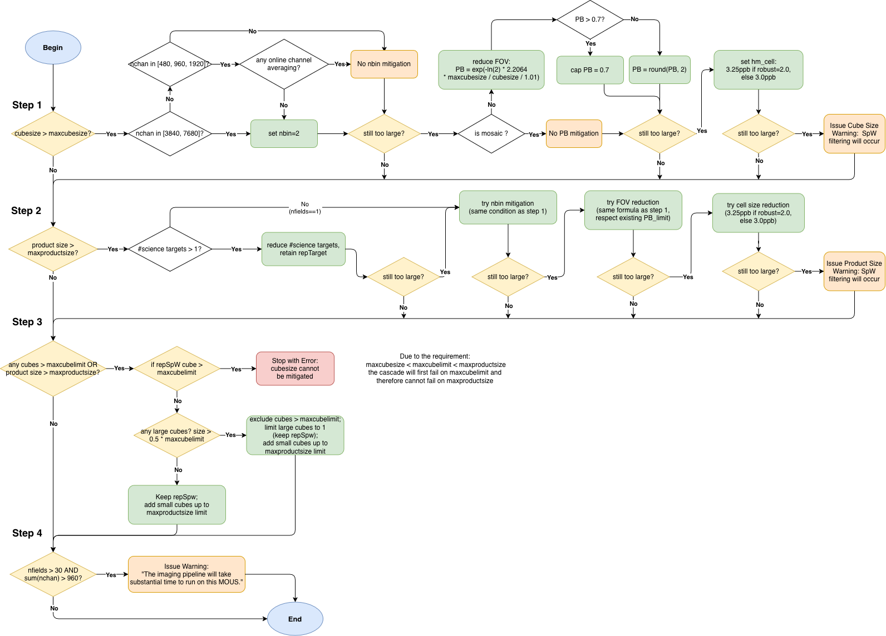
*Tickets: [PIPE-2812](https://open-jira.nrao.edu/browse/PIPE-2812),
[PIPE-3127](https://open-jira.nrao.edu/browse/PIPE-3127).*
[PIPE-2909](https://open-jira.nrao.edu/browse/PIPE-2909) lets cube imaging
continue with a truncated channel grid instead of failing when a
user-specified frequency grid extends beyond the spw coverage.
[PIPE-3157](https://open-jira.nrao.edu/browse/PIPE-3157) fixes a blank
flat-noise image min/max in the weblog for VLASS workflows, a regression
from the pbcor/non-pbcor separation in PIPE-2073.

---

(sd-heuristics)=
## SD heuristic changes

*(not weblog or QA)*

**Imaging: migration to true Stokes I.**
{func}`hsd_imaging <pipeline.hsd.cli.hsd_imaging>` now images with
`stokes="I"` instead of the previous `stokes="pseudoI"` workaround, now that
a CASA-side behavior change (CAS-9957/CAS-14444) makes the two equivalent.
That migration in turn let the `WeightMS` subtask's weight-column
manipulation be skipped entirely, since it produces values consistent with
what {func}`sdbaseline <casatasks.single.sdbaseline>` already sets —
improving imaging performance.
*Tickets: [PIPE-2490](https://open-jira.nrao.edu/browse/PIPE-2490),
[PIPE-2671](https://open-jira.nrao.edu/browse/PIPE-2671),
[PIPE-2491](https://open-jira.nrao.edu/browse/PIPE-2491).*

**Skycal / atmospheric-correction fixes.**
[PIPE-2565](https://open-jira.nrao.edu/browse/PIPE-2565) fixes the
"Show plot command" feature for Amp-vs-Time plots, which only showed the
last of several `plotms` calls used to build a multi-field overplot.
[PIPE-2965](https://open-jira.nrao.edu/browse/PIPE-2965) fixes a missing
MS filter on the detailed Amp-vs-Freq plot page for some datasets.
[PIPE-3198](https://open-jira.nrao.edu/browse/PIPE-3198) fixes the
Elevation Difference vs. Time plot showing flagged data points that should
have been excluded.
[PIPE-3199](https://open-jira.nrao.edu/browse/PIPE-3199) skips QA evaluation
instead of crashing (`zero-size array to reduction operation maximum`) when
a metric has no valid values.
[PIPE-2945](https://open-jira.nrao.edu/browse/PIPE-2945) stops
{func}`hsd_skycal <pipeline.hsd.cli.hsd_skycal>` from crashing the whole run
when it fails to generate a sky caltable for just one of several science
targets — it now flags the affected rows and continues processing the rest
(with a secondary fix to how the AQUA report reflects the affected metric).
[PIPE-2774](https://open-jira.nrao.edu/browse/PIPE-2774) revisits the
`atmtype` selection algorithm in
{func}`hsd_atmcor <pipeline.hsd.cli.hsd_atmcor>` after PL2025 was found to
sometimes choose a worse type than PL2024.
[PIPE-1781](https://open-jira.nrao.edu/browse/PIPE-1781) enables Tier-0
(MPI) parallelization for {func}`hsd_atmcor <pipeline.hsd.cli.hsd_atmcor>`, now that the underlying {func}`sdatmcor <casatasks.single.sdatmcor>`
CASA task's OpenMP threading is confirmed not to conflict with `mpicasa`.
[PIPE-3167](https://open-jira.nrao.edu/browse/PIPE-3167) fixes an old
absolute-off-position naming convention (`Target_0`) being misread as both
an off position and an independent target source.
[PIPE-3119](https://open-jira.nrao.edu/browse/PIPE-3119) combines pointing
data across all antennas for the pointing-outlier heuristic, so a single
bad antenna's valid data isn't misclassified as outliers when compared only
against itself.

**Jy/K calibration.**
[PIPE-2967](https://open-jira.nrao.edu/browse/PIPE-2967) lets
{func}`hsd_k2jycal <pipeline.hsd.cli.hsd_k2jycal>` fall back to a backup
URL (JAO, then EA/NA/EU) if the primary Jy/K database query fails.
[PIPE-3146](https://open-jira.nrao.edu/browse/PIPE-3146) fixes the weblog
incorrectly reporting a successful Jy/K database access when
`dbservice=False`.

**Baseline-fitting heuristics.**
[PIPE-3161](https://open-jira.nrao.edu/browse/PIPE-3161) improves the
{func}`hsd_baseline <pipeline.hsd.cli.hsd_baseline>` QA messages to report the virtual spw (not the real,
per-MS spw) for line-detection scores, avoiding confusing MS-specific
numbering in multi-MS runs.
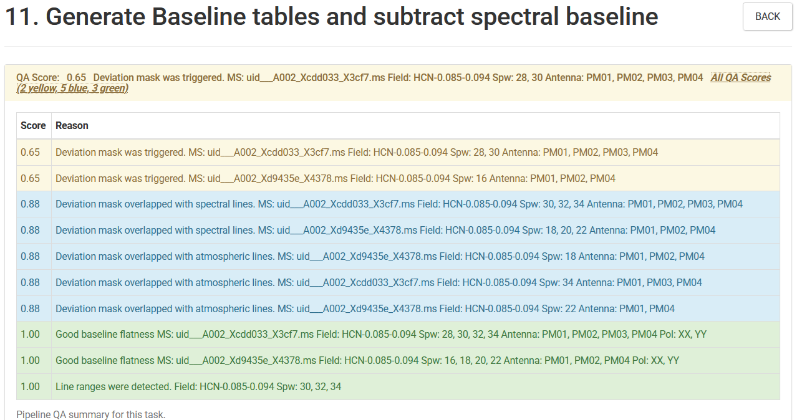
Wide/edge line QA not triggering was fixed, and the representative line
width used for clustering was switched to the 75th percentile of the
detected cluster rather than the central value, which had been
underestimating width.
*Tickets: [PIPE-2959](https://open-jira.nrao.edu/browse/PIPE-2959),
[PIPE-2964](https://open-jira.nrao.edu/browse/PIPE-2964).*
[PIPE-2695](https://open-jira.nrao.edu/browse/PIPE-2695) fixes
{func}`hsd_baseline <pipeline.hsd.cli.hsd_baseline>` crashing when k-means clustering is attempted with fewer
line detections than requested clusters.
[PIPE-3001](https://open-jira.nrao.edu/browse/PIPE-3001) audits and fixes
confusion between real and virtual spw IDs in `baseline/worker.py`.
[PIPE-2893](https://open-jira.nrao.edu/browse/PIPE-2893) adds a `sinusoid`
fitting-function option to
{func}`hsd_baseline <pipeline.hsd.cli.hsd_baseline>`, with a new
`wavenumber` parameter (list/per-spw/per-EB inputs supported).
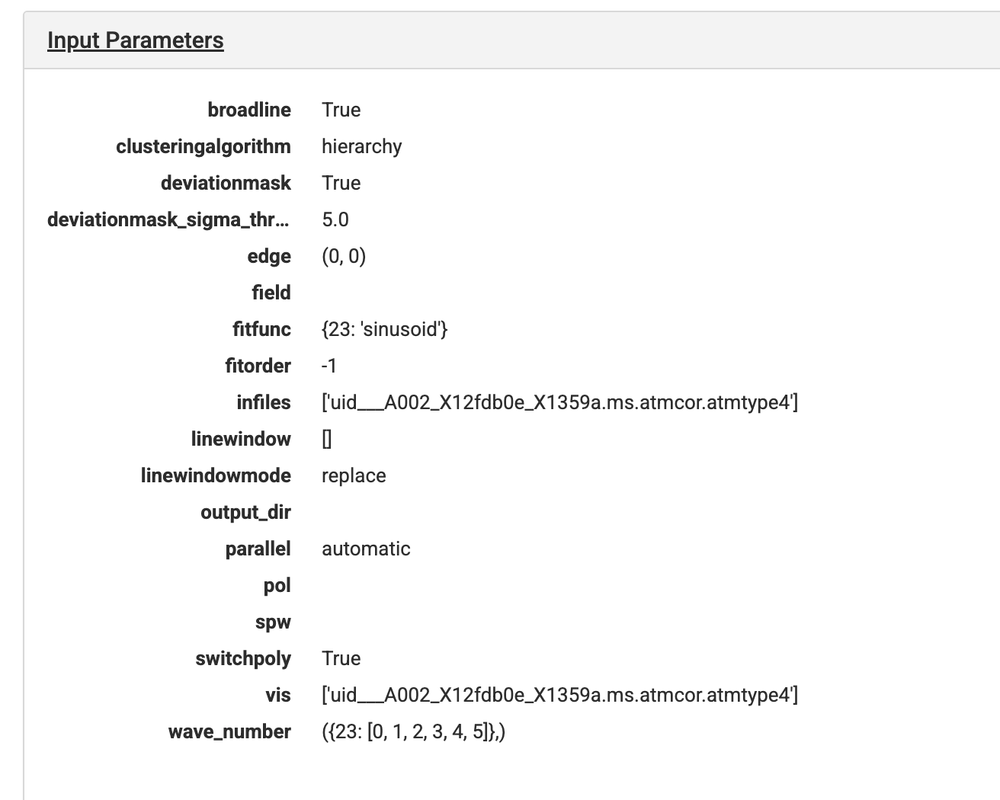

**Imaging QA / diagnostics.**
False-positive QA warnings for contamination diagnostic plots were reduced
by excluding edge channels and ATM-line-overlapping channels from the
metric; the same technique was then applied to the missed-line-channel
diagnostic plots.
*Tickets: [PIPE-2946](https://open-jira.nrao.edu/browse/PIPE-2946),
[PIPE-3092](https://open-jira.nrao.edu/browse/PIPE-3092).*
[PIPE-3160](https://open-jira.nrao.edu/browse/PIPE-3160) and
[PIPE-3109](https://open-jira.nrao.edu/browse/PIPE-3109) fix `IndexError`
crashes generating the channel-map and missed-line diagnostic plots when a
clustering-derived line range extends outside the valid channel bounds.
[PIPE-2399](https://open-jira.nrao.edu/browse/PIPE-2399) fixes inconsistent
display of flagged data at the {func}`hsd_blflag <pipeline.hsd.cli.hsd_blflag>` stage — flagged points above
the threshold line were sometimes rendered as unflagged.
[PIPE-3192](https://open-jira.nrao.edu/browse/PIPE-3192) fixes the
{func}`hsd_exportdata <pipeline.hsd.cli.hsd_exportdata>` weblog page not
being generated properly.
[PIPE-3194](https://open-jira.nrao.edu/browse/PIPE-3194) fixes a recurrence
of a previously-fixed (PIPE-2789) bug where some panels of the
{func}`hsd_applycal <pipeline.hsd.cli.hsd_applycal>` XX-YY amplitude-difference-vs-frequency plot were empty.
[PIPE-2920](https://open-jira.nrao.edu/browse/PIPE-2920) fixes the pointing
outlier log message reporting its separation in the wrong unit (arcsec
instead of deg, inconsistent with the QA score message).

**Framework / cross-cutting SD fixes.**
[PIPE-2913](https://open-jira.nrao.edu/browse/PIPE-2913) fixes handling of
pointing distributions that straddle RA=12h (CASA's measures tool wraps RA
to ±180°, which can split a raster map into two disjoint chunks) using
`numpy.unwrap`.
[PIPE-3035](https://open-jira.nrao.edu/browse/PIPE-3035) fixes Tier-0
parallel parameter distribution for SD tasks, which assumed the scope
attribute was always `vis` instead of `infiles`.
[PIPE-3129](https://open-jira.nrao.edu/browse/PIPE-3129) fixes missing
per-beam XX/YY image products specific to the NRO Pipeline.
[PIPE-2718](https://open-jira.nrao.edu/browse/PIPE-2718) is a refactor of
{func}`hsd_applycal <pipeline.hsd.cli.hsd_applycal>` display/QA code for filename consistency and simplification.
[PIPE-2754](https://open-jira.nrao.edu/browse/PIPE-2754) and
[PIPE-2857](https://open-jira.nrao.edu/browse/PIPE-2857) fix a trivial
selected-table-object bug causing inconsistent ATM-cal data, and a
randomly-changing color map in the XX-YY difference plot.
[PIPE-2954](https://open-jira.nrao.edu/browse/PIPE-2954) fixes a misspelling
("futher" → "further") in a warning message.

---

(if-weblog-qa)=
## IF weblog and QA changes

Organized by weblog stage/page, following the curated PL2026 weblog
checklist and the
[`hifa_polcalimage` recipe](https://pipe-docs.readthedocs.io/en/docs-update-pl2026/users_guide/hifa_polcalimage-recipe.html)
order.

**Environment / landing page.**
[PIPE-2644](https://open-jira.nrao.edu/browse/PIPE-2644) adds Python and
third-party library version info (and optionally GPU hardware specs) to the
weblog's environment splash page, so this no longer requires digging
through the CASA log.

**Per-MS overview / Spectral Setup Details.**
[PIPE-117](https://open-jira.nrao.edu/browse/PIPE-117) adds Resolution
columns (MHz and km/s) to the Spectral Setup Details table, alongside the
existing channel-width columns.
[PIPE-3095](https://open-jira.nrao.edu/browse/PIPE-3095) fixes the
Correlation Bits column incorrectly showing `BITS_4x4` for old ALMA data
where that value is not actually known (CASA's `msmd.corrbit()` correctly
reports `UNKNOWN`, but the pipeline wasn't passing that through).

**{func}`hifa_flagdata <pipeline.hifa.cli.hifa_flagdata>` / {func}`hif_applycal <pipeline.hif.cli.hif_applycal>` QA-score re-tuning.**
[PIPE-3036](https://open-jira.nrao.edu/browse/PIPE-3036) and
[PIPE-3037](https://open-jira.nrao.edu/browse/PIPE-3037) shift the
"percent flagged" QA score for
{func}`hifa_flagdata <pipeline.hifa.cli.hifa_flagdata>` and the
"newly flagged" score for
{func}`hif_applycal <pipeline.hif.cli.hif_applycal>` upward, based on an
analysis (PIPEREQ-399 item 3) showing the old thresholds were flagging too
many good datasets yellow instead of blue, keeping more data eligible for
ALMA's FastLane without materially increasing bad data reaching PIs.
[PIPE-2716](https://open-jira.nrao.edu/browse/PIPE-2716) adds the
calibration intent to `applycalQA_outliers.txt` so outlying data points can
be traced back to their scan/intent.
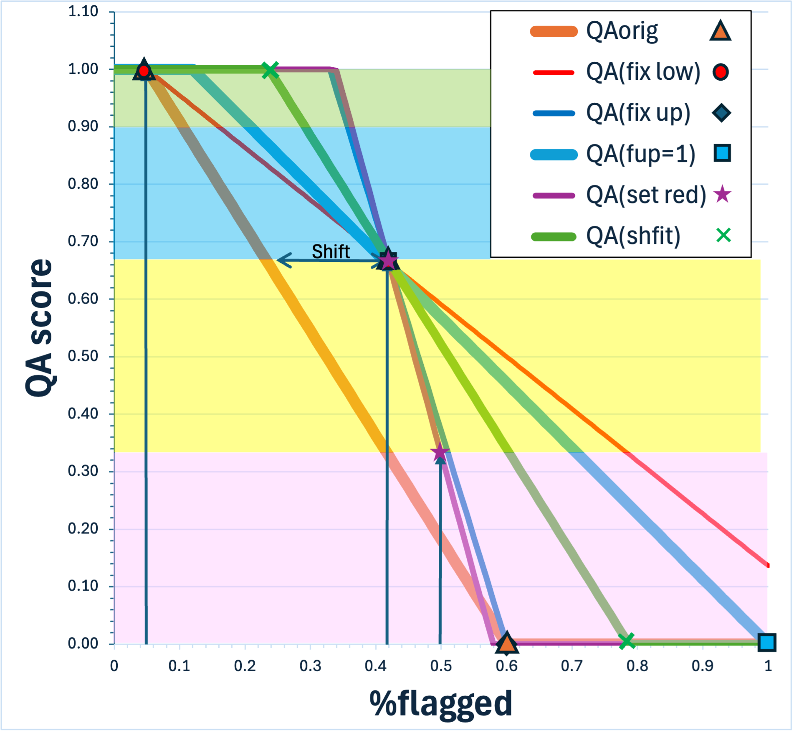

**{func}`hifa_wvrgcalflag <pipeline.hifa.cli.hifa_wvrgcalflag>`.**
[PIPE-1868](https://open-jira.nrao.edu/browse/PIPE-1868) changes the
WVRGCALFLAG score for ACA data with insufficient PM antennas from red to
yellow — a single flagged PM antenna could previously trigger a red score
meant for main-array-scale failures.
[PIPE-1316](https://open-jira.nrao.edu/browse/PIPE-1316) fixes two ordering
issues in the {func}`hifa_wvrgcalflag <pipeline.hifa.cli.hifa_wvrgcalflag>` weblog table and plots (intent/field
ordering that changed between CASA versions, and inconsistent per-antenna
ordering) — this shares root-cause work with the PIPE-901
deterministic-ordering initiative (see {ref}`Infrastructure <infrastructure>`).
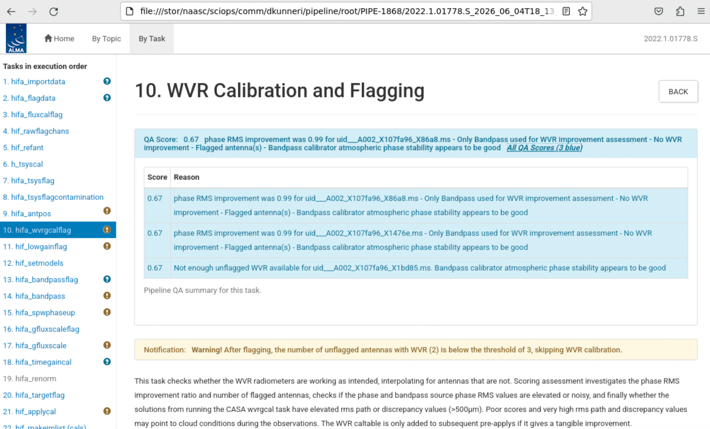

**{func}`hifa_bandpass <pipeline.hifa.cli.hifa_bandpass>` / {func}`hifa_gfluxscale <pipeline.hifa.cli.hifa_gfluxscale>`.**
[PIPE-2845](https://open-jira.nrao.edu/browse/PIPE-2845) is a set of
follow-ups to the PIPE-2103 subband QA work: per-spw (not per-spw-per-antenna)
log messages, amp/phase-separated QA-message aggregation, and skipping PNG
plot creation by default.
[PIPE-2553](https://open-jira.nrao.edu/browse/PIPE-2553) adds a QA metric to
{func}`hifa_gfluxscale <pipeline.hifa.cli.hifa_gfluxscale>` that flags large
amplitude-vs-time variation for the flux calibrator as a possible QA0
SemiPass candidate.

**{func}`hif_makeimages <pipeline.hif.cli.hif_makeimages>` (calibrator / check-source / target).**
[PIPE-3082](https://open-jira.nrao.edu/browse/PIPE-3082) changes the RepBW
cube QA so the `mom8fc` subscore doesn't turn yellow purely because the
coarser RepBW resolution pulls line emission into the continuum-frequency
ranges, when the full-resolution cube for the same spw/source scored well.
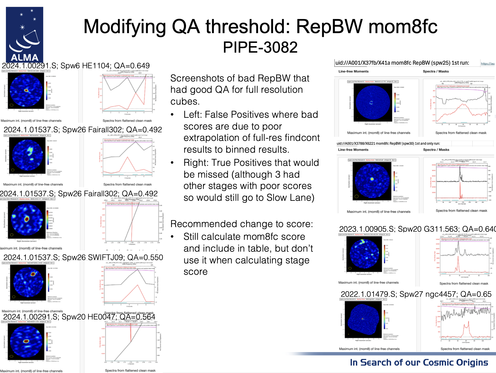
[PIPE-3042](https://open-jira.nrao.edu/browse/PIPE-3042) similarly re-tunes
the check-source-fit QA aggregation function (PIPEREQ-399 item 3).

**Determinism / ordering.**
[PIPE-888](https://open-jira.nrao.edu/browse/PIPE-888) replaces `list(set(...))`
with a deterministic `utils.deduplicate()` in flagging-command construction
across {func}`hif_lowgainflag <pipeline.hif.cli.hif_lowgainflag>`, {func}`hif_rawflagchans <pipeline.hif.cli.hif_rawflagchans>` and {func}`hifa_tsysflag <pipeline.hifa.cli.hifa_tsysflag>`, so
`casa_commands.log` no longer differs in flag-statement order between
identical runs at different ARCs.
[PIPE-3089](https://open-jira.nrao.edu/browse/PIPE-3089) fixes caltable
filenames that could differ between serial and parallel execution for some
ALMA calibration tasks, since the parallel-worker filename template wasn't
consistently using the registered task name.
[PIPE-2698](https://open-jira.nrao.edu/browse/PIPE-2698) and
[PIPE-2869](https://open-jira.nrao.edu/browse/PIPE-2869) fix the Tsys
scan plot: pre-Cycle-3 data no longer attempts (and fails) to plot
`ON_SOURCE`/`TEST` intents that didn't exist yet, and a non-deterministic
offset-position calculation that made the plot change between identical
reruns is now fixed.
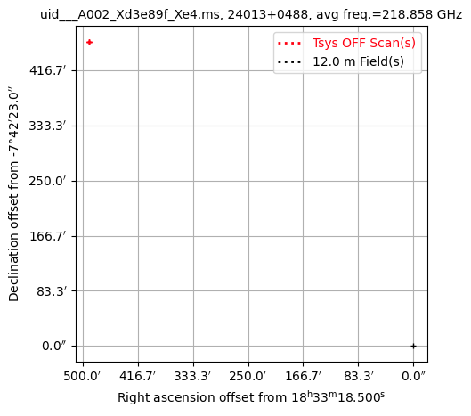

**Polarization-specific weblog.**
{func}`hif_makeimages <pipeline.hif.cli.hif_makeimages>` polarization Stokes IQUV image inheritance and repBW
mask/threshold fixes are covered together with the underlying imaging
changes in
{ref}`IF imaging heuristics <if-imaging>` (PIPE-3074/PIPE-3096/PIPE-3128).

---

(aqua)=
### AQUA report

[PIPE-2470](https://open-jira.nrao.edu/browse/PIPE-2470) adds ASDM/EB UIDs
to the Project Structure section of `pipeline_aquareport.xml`, to support
the proposed per-EB Fast Feedback calibration workflow.
[PIPE-2489](https://open-jira.nrao.edu/browse/PIPE-2489) fixes image names
in the AQUA report's `<Sensitivity>` entries to include the multiterm
extension instead of just the base name.
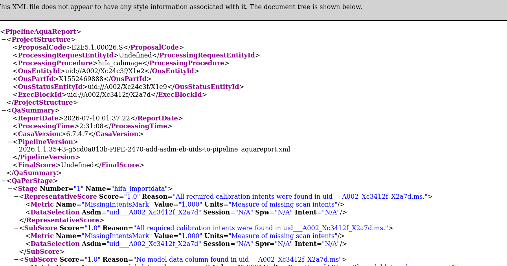
[PIPE-3014](https://open-jira.nrao.edu/browse/PIPE-3014) extends the AQUA
report's imaging statistics to cover Stokes Q, U and V target images for
polarization-calibration runs, not just Stokes I.
[PIPE-65](https://open-jira.nrao.edu/browse/PIPE-65) adds the phase/target/check-source
great-circle separation angles, as values and a plot, to both the weblog
and the AQUA report.
[PIPE-3034](https://open-jira.nrao.edu/browse/PIPE-3034) fixes an AQUA
report formatting error where a single-string `vis`/ASDM description in the
`DataSelection` block was being comma-split character-by-character for
non-full-polarization recipes.
[PIPE-2073](https://open-jira.nrao.edu/browse/PIPE-2073) adds the
non-primary-beam-corrected image peak flux to the AQUA report alongside the
existing PB-corrected value, useful for evaluating self-calibration.

---

(sd-weblog-qa)=
## SD weblog and QA changes

Organized by weblog stage/page, following the
[`hsd_calimage` recipe](https://pipe-docs.readthedocs.io/en/docs-update-pl2026/users_guide/hsd_calimage-recipe.html)
order.

**QA-message aggregation, rolled out stage by stage.** A consistent piece of
work aggregates repeated QA messages from the same metric/score into a
single accordion entry (matching the existing IF weblog style), applied in
turn to
{func}`hsd_applycal <pipeline.hsd.cli.hsd_applycal>`
([PIPE-3055](https://open-jira.nrao.edu/browse/PIPE-3055)),
{func}`hsd_baseline <pipeline.hsd.cli.hsd_baseline>`
([PIPE-3054](https://open-jira.nrao.edu/browse/PIPE-3054)),
{func}`hsd_imaging <pipeline.hsd.cli.hsd_imaging>`
([PIPE-3104](https://open-jira.nrao.edu/browse/PIPE-3104)), and finally
`hsd_k2jycal`, {func}`hsd_atmcor <pipeline.hsd.cli.hsd_atmcor>` and {func}`hsd_blflag <pipeline.hsd.cli.hsd_blflag>` together
([PIPE-3143](https://open-jira.nrao.edu/browse/PIPE-3143)) — {func}`hsd_skycal <pipeline.hsd.cli.hsd_skycal>`
is deliberately left for separate treatment since its QA involves nested
aggregation that doesn't fit the common pattern.
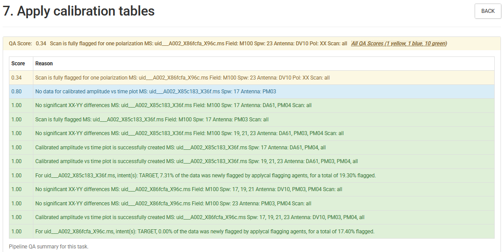

**QA scoring and message ordering.**
[PIPE-2958](https://open-jira.nrao.edu/browse/PIPE-2958) adds a new QA score
based on the ratio of observed to theoretical image RMS at the
{func}`hsd_imaging <pipeline.hsd.cli.hsd_imaging>` stage.
[PIPE-2988](https://open-jira.nrao.edu/browse/PIPE-2988) sorts weblog QA
messages within the same color band by score, so the lowest score in each
band is easy to spot (a PLWG request from PIPEREQ-424).

**{func}`hsd_baseline <pipeline.hsd.cli.hsd_baseline>` weblog.**
[PIPE-2867](https://open-jira.nrao.edu/browse/PIPE-2867) fixes a
"spectral"/"spectra" typo in the averaged-spectrum caption.
[PIPE-2776](https://open-jira.nrao.edu/browse/PIPE-2776) cleans up
double/missing periods and inconsistent punctuation in `hsd_baseline`'s "By
Topic" QA messages, aligning the style with the IF weblog.
[PIPE-2894](https://open-jira.nrao.edu/browse/PIPE-2894) adds a channel axis
to the top panel of the sparse profile map (already done in the Nobeyama
Pipeline).
[PIPE-3047](https://open-jira.nrao.edu/browse/PIPE-3047) adds an
explanatory caption to the missed-line-channel diagnostic plots at the
{func}`hsd_imaging <pipeline.hsd.cli.hsd_imaging>` stage, describing the
single-peak/extended detection thresholds and the plot's color coding.
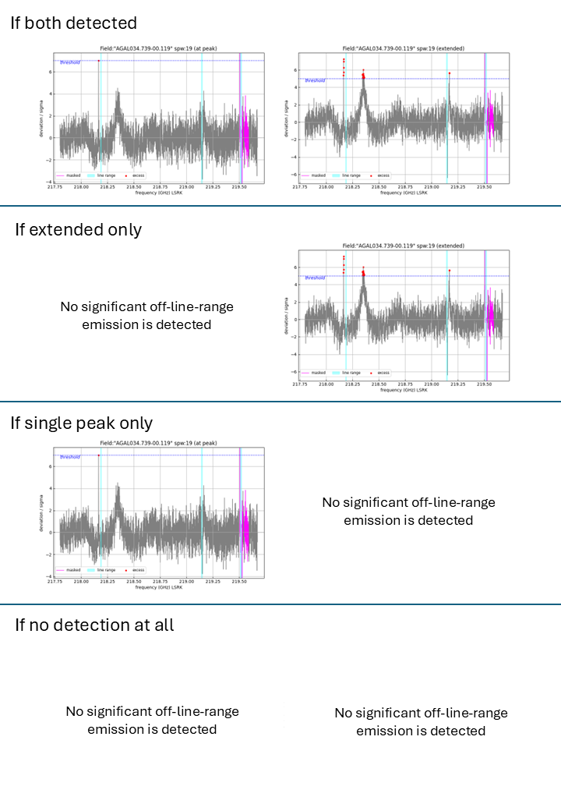
[PIPE-3141](https://open-jira.nrao.edu/browse/PIPE-3141) fixes an inverted
channel range for the `hsd_imaging` moment-map plot in LSB data.

**Tsys scan plot (shared page).**
[PIPE-2869](https://open-jira.nrao.edu/browse/PIPE-2869) — see
{ref}`IF weblog/QA <if-weblog-qa>` above; this fix applies to the same
`TsysScansChart` shared by both recipes.

### AQUA report

[PIPE-3138](https://open-jira.nrao.edu/browse/PIPE-3138) fixes the AQUA
report containing sensitivity estimates for more than one
`IsRepresentative = True` target — the representative source should be
unique per MOUS; this turned out to be an SD-specific bug in how the
representative source is picked (handling of representative source in the
wider pipeline codebase is out of scope for this fix and needs separate
IF/SD discussion). See also the general-purpose AQUA-report changes in
{ref}`IF weblog/QA → AQUA report <aqua>`, which apply to both recipes.

---

(documentation)=
## Documentation

Tracked under the **Documentation PL2026** epic
([PIPE-2738](https://open-jira.nrao.edu/browse/PIPE-2738)).

[PIPE-2890](https://open-jira.nrao.edu/browse/PIPE-2890) extracts Pipeline
task subsections from the User Guide into each task's CLI docstring
(AI-assisted first pass, manual cleanup, PLWG review), part of a broader
restructuring and Sphinx/Read the Docs theme migration.
[PIPE-2897](https://open-jira.nrao.edu/browse/PIPE-2897) adds a
getting-started guide and high-level architectural overview to the
Read the Docs pipeline documentation.
[PIPE-3190](https://open-jira.nrao.edu/browse/PIPE-3190) is the tracking
ticket for the full 2026 User Guide review (quickstart, what's-new,
versions, data-processing files, `casa_pipescript`, helper files, weblog
overview, IF/SD task pages).
[PIPE-1682](https://open-jira.nrao.edu/browse/PIPE-1682) proposes keeping a
live pipeline dependency specification (requirements.txt / conda env file)
in the codebase, maintained as part of the normal PR review process.
[PIPE-2152](https://open-jira.nrao.edu/browse/PIPE-2152) clarifies what the
`parallel` argument actually does across different task CLI docstrings
(tier-1 CASA/imager parallelization vs. {func}`tclean <casatasks.imaging.tclean>`(parallel=True) vs. Tier-0
task-level parallelization), which had been inconsistently documented.
[PIPE-2870](https://open-jira.nrao.edu/browse/PIPE-2870) fixes two wrong CLI
argument names surfaced during documentation review:
`hm_resolvecals` → `hm_resolvedcals` in
{func}`hifa_gfluxscale <pipeline.hifa.cli.hifa_gfluxscale>`, and
`linesfiles` → `linesfile` in
{func}`hifa_fluxcalflag <pipeline.hifa.cli.hifa_fluxcalflag>`.

---

(infrastructure)=
## Infrastructure and performance

Tracked under the **Refactor/Infra PL2026**
([PIPE-2736](https://open-jira.nrao.edu/browse/PIPE-2736)),
**Improve Pipeline performance for PL2026**
([PIPE-2735](https://open-jira.nrao.edu/browse/PIPE-2735)) and
**Improve Pipeline testing for PL2026**
([PIPE-2737](https://open-jira.nrao.edu/browse/PIPE-2737)) epics, plus the
**Resolve unpredictable ordering in various areas of the Pipeline**
initiative ([PIPE-901](https://open-jira.nrao.edu/browse/PIPE-901)).

**Determinism (PIPE-901).**
Beyond the weblog-visible fixes already covered in the weblog/QA sections
(PIPE-888, PIPE-1316, PIPE-3089), this initiative underlies several changes
to make repeated pipeline runs on identical inputs produce identical
outputs.
[PIPE-2274](https://open-jira.nrao.edu/browse/PIPE-2274) stops a second,
end-of-imaging call to
{func}`hifa_exportdata <pipeline.hifa.cli.hifa_exportdata>` from attempting
to overwrite the same `Pipeline_Final` flag-version name used by the
first, end-of-calibration call ({func}`flagmanager <casatasks.flagging.flagmanager>` behavior otherwise
timestamp-renames the earlier one, sometimes within seconds).

**Timing/performance instrumentation.**
[PIPE-2014](https://open-jira.nrao.edu/browse/PIPE-2014) improves the
timing statistics recorded in `timetracker.json` and the weblog — the
previous "Execution Duration" on the OUS splash page under-counted because
that page renders before weblog-rendering time is included.

**Compatibility / dependency maintenance.**
[PIPE-3116](https://open-jira.nrao.edu/browse/PIPE-3116) fixes an
`AttributeError` in a Matplotlib `_SentinelMap` helper surfaced by
Matplotlib 3.11+.
[PIPE-2665](https://open-jira.nrao.edu/browse/PIPE-2665) replaces
deprecated single-element-array-to-scalar NumPy conversions, and
[PIPE-2664](https://open-jira.nrao.edu/browse/PIPE-2664) replaces the
deprecated `np.in1d` with `np.isin`.
[PIPE-2209](https://open-jira.nrao.edu/browse/PIPE-2209) replaces a call to
the deprecated `AntennaArray.baselines` property with
`AntennaArray.baselines_m`.
[PIPE-2891](https://open-jira.nrao.edu/browse/PIPE-2891) adds `me.done()`
calls after `me.doframe()` and clears the CASA measures-tool time cache
around ASDM import, guarding against stateful cross-talk between imports.
[PIPE-2674](https://open-jira.nrao.edu/browse/PIPE-2674) fixes a
`ResourceWarning` from an unclosed file handle in `environment.py` at
startup, and [PIPE-3015](https://open-jira.nrao.edu/browse/PIPE-3015)
fixes a similar unclosed-file-handle issue in `rendererutils.num_lines()`.
Pipeline compatibility with modular CASA and a standard Python interpreter
was investigated and scoped: no significant blockers were identified, and
the main open question is the restore-script interface.
*Tickets: [PIPE-1669](https://open-jira.nrao.edu/browse/PIPE-1669),
[PIPE-707](https://open-jira.nrao.edu/browse/PIPE-707).*

**Build, packaging and testing.**
[PIPE-2906](https://open-jira.nrao.edu/browse/PIPE-2906),
[PIPE-2922](https://open-jira.nrao.edu/browse/PIPE-2922),
[PIPE-3027](https://open-jira.nrao.edu/browse/PIPE-3027) and
[PIPE-3135](https://open-jira.nrao.edu/browse/PIPE-3135) cover the
PL2026/CASA 6.7.x build-plan switch, branching and packaging work
(`release/2026.2.0`), and dedicated Bamboo test plans for the CASA 6.7.4
combination.

**Code health / cleanup.**
[PIPE-2638](https://open-jira.nrao.edu/browse/PIPE-2638) restructures the
pipeline-stats code to make adding new stats easier, without changing
existing behavior.
[PIPE-2651](https://open-jira.nrao.edu/browse/PIPE-2651) removes the unused
legacy `hifacal.py`, `hifatargets.py` and `hsd.py` modules.
[PIPE-2865](https://open-jira.nrao.edu/browse/PIPE-2865) fixes an ordering
bug between the `fluxscale`/`setmodel` `transfer` field pre-check logic.
[PIPE-3079](https://open-jira.nrao.edu/browse/PIPE-3079) documents the
pipeline context object's use cases and proposes improvements to it.
