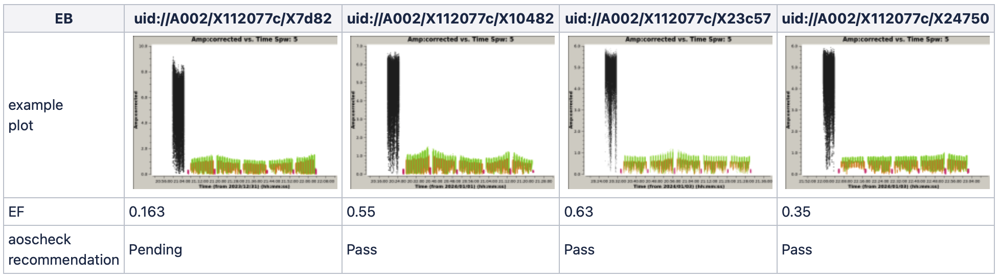
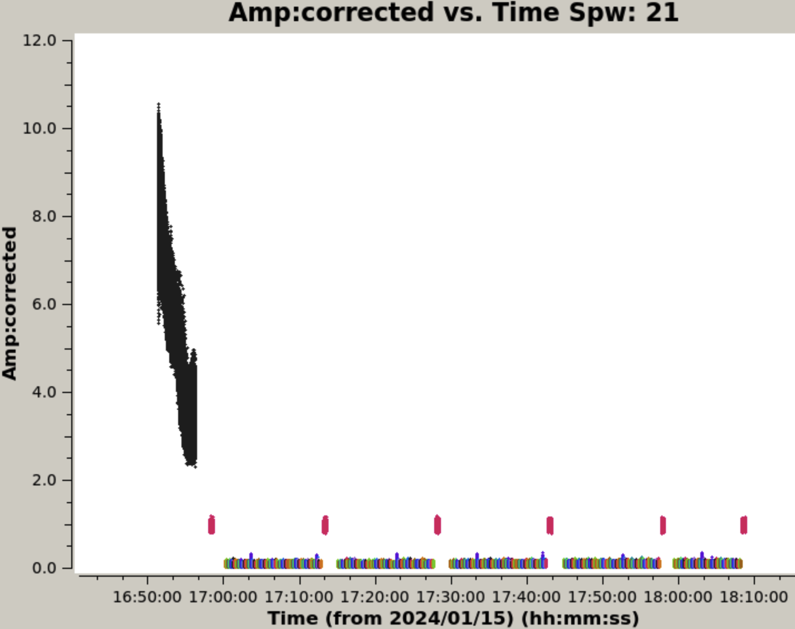

# ALMA Pipeline — What's New 2026

## Major New Capabilities

A few of the more consequential ALMA interferometric and single-dish changes from this period (see below for details of each)

- **New QA scoring for single-dish imaging and calibration.** Several new or reworked QA metrics landed for the single-dish (`hsd`) pipeline, including an image-RMS-ratio-based score for {func}`hsd_imaging <pipeline.hsd.cli.hsd_imaging>` ([PIPE-2958](https://open-jira.nrao.edu/browse/PIPE-2958)) and aggregated multi-stage QA messaging for {func}`hsd_k2jycal <pipeline.hsd.cli.hsd_k2jycal>`/{func}`hsd_atmcor <pipeline.hsd.cli.hsd_atmcor>`/{func}`hsd_blflag <pipeline.hsd.cli.hsd_blflag>` ([PIPE-3143](https://open-jira.nrao.edu/browse/PIPE-3143), [PIPE-3054](https://open-jira.nrao.edu/browse/PIPE-3054)).

- **New amplitude-time QA metric for ALMA flux scaling.** {func}`hifa_gfluxscale <pipeline.hifa.cli.hifa_gfluxscale>` gained a new amplitude-vs-time QA metric to catch flux-calibration problems earlier ([PIPE-2553](https://open-jira.nrao.edu/browse/PIPE-2553)).

- **New cross-polarization flagging control for ALMA polarization calibration**, `examineCrossPolSum`, to catch cross-hand flagging issues. ([PIPE-2956](https://open-jira.nrao.edu/browse/PIPE-2956))

- **New sinusoid-fitting option for {func}`hsd_baseline <pipeline.hsd.cli.hsd_baseline>`.** ([PIPE-2893](https://open-jira.nrao.edu/browse/PIPE-2893))

- **Documentation platform rebuilt on Pixi + GitHub Pages.** The `docs/` build and CI system was overhauled to use the `pixi` environment/task manager and official GitHub Actions for Pages deployment, part of a broad, ongoing documentation-modernization ticket ([PIPE-2738](https://open-jira.nrao.edu/browse/PIPE-2738)).

- **New MS-frame re-gridding mode for {func}`hif_mstransform <pipeline.hif.cli.hif_mstransform>`.** A large, multi-ticket effort ([PIPE-3003](https://open-jira.nrao.edu/browse/PIPE-3003), [PIPE-3057](https://open-jira.nrao.edu/browse/PIPE-3057), [PIPE-3053](https://open-jira.nrao.edu/browse/PIPE-3053), [PIPE-2955](https://open-jira.nrao.edu/browse/PIPE-2955) implemented a new {func}`hif_mstransform <pipeline.hif.cli.hif_mstransform>` mode that creates imaging MeasurementSets re-gridded to the native frequency frame, added a `per_spw` option for splitting MSes by spectral window, and renamed the pipeline's internal "topocentric" frame-handling to the more general "`_ms_frame`" convention throughout the imaging stages.

- **New {func}`hif_findroi <pipeline.hif.cli.hif_findroi>` task added to the ALMA imaging recipes.** A new region-of-interest–finding stage was added and wired into the standard ALMA imaging recipe templates ([PIPE-3151](https://open-jira.nrao.edu/browse/PIPE-3151), [PIPE-3149](https://open-jira.nrao.edu/browse/PIPE-3149), [PIPE-3136](https://open-jira.nrao.edu/browse/PIPE-3136), [PIPE-3162](https://open-jira.nrao.edu/browse/PIPE-3162), [PIPE-3150](https://open-jira.nrao.edu/browse/PIPE-3150), [PIPE-3191](https://open-jira.nrao.edu/browse/PIPE-3191)).  An approximate but very fast dirty image is created with nearest-neighbor gridding, in order to extract a spectrum of the source.  

### First stages of a refactor of the imaging pipeline:

Frame regridding and hif_findroi are the first steps of a multi-year process -- On their own they do not significantly change the image products or the speed to produce those products, but are critical foundational work that will enable creation of more scientifically impactful selections of images in less processing time, and provide the necessary flexibility to handle the coming Wideband Sensitivity Upgrade (WSU). After the WSU, spectral windows will have significantly more channels, and the resulting cubes will be very large, while cube imaging already dominates ALMA data processing time.  The imaging pipeline refactor will:
   - use hif_findroi instead of hif_findcont to identify and exclude strong lines without needing to create large image cubes at all (even dirty ones).  Those frequency ranges will be sufficient to run self-calibration.
   - transform the self-calibrated visibilities into the source frame (usually LSRK), with careful averaging to reduce data volume
   - create continuum images
   - create cube images
   - if predicted data volume or processing time is too large, currently the ALMA pipeline simply doesn't create some images (mitigation -- see {func}`hif_checkproductsize <pipeline.hif.cli.hif_checkproductsize>`). In the future, hifa_findroi results will be used to prioritize the subset of images that actually contain emission if subselection is required.
   - finally, once a RADPS cube imager is available, a clean transition can be made to image cubes after the ALMA pipeline runs through continuum imaging, allowing a simpler and more easily maintained software stack.

---
---

## Detailed list: IF Imaging & Continuum Subtraction

- **New {func}`hif_findroi <pipeline.hif.cli.hif_findroi>` region-of-interest task** added to the ALMA imaging recipe templates, with a `field` parameter for targeted use and later refactored to read polarization data directly from the MS. ([PIPE-3151](https://open-jira.nrao.edu/browse/PIPE-3151), [PIPE-3149](https://open-jira.nrao.edu/browse/PIPE-3149), [PIPE-3196](https://open-jira.nrao.edu/browse/PIPE-3196), [PIPE-3164](https://open-jira.nrao.edu/browse/PIPE-3164), [PIPE-3156](https://open-jira.nrao.edu/browse/PIPE-3156))
- **New {func}`hif_mstransform <pipeline.hif.cli.hif_mstransform>` re-gridding mode** that creates imaging MSes re-gridded to the native frequency frame, plus a new `per_spw` splitting option. ([PIPE-3003](https://open-jira.nrao.edu/browse/PIPE-3003), [PIPE-2955](https://open-jira.nrao.edu/browse/PIPE-2955))
- **{func}`hif_findcont <pipeline.hif.cli.hif_findcont>` heuristics extended:** added `mosweight` support and a requirement that `datacolumn` be set for multi-MS vis lists ([PIPE-3131](https://open-jira.nrao.edu/browse/PIPE-3131)); additional exposed parameters for continuum-finding control ([PIPE-3197](https://open-jira.nrao.edu/browse/PIPE-3197), [PIPE-3159](https://open-jira.nrao.edu/browse/PIPE-3159)); switched to using `uvrange` ([PIPE-2617](https://open-jira.nrao.edu/browse/PIPE-2617)); fixed a `skip_stage` bug that could produce a blank `cont.dat` ([PIPE-3137](https://open-jira.nrao.edu/browse/PIPE-3137), [PIPE-2255](https://open-jira.nrao.edu/browse/PIPE-2255)); `findContinuum.py` updated to v9.6 ([PIPE-2766](https://open-jira.nrao.edu/browse/PIPE-2766)).
- **`cont.dat` UX improvements:** the weblog now notes when a `cont.dat` file is present, and the "no cont.dat found" log message was downgraded from warning to info. ([PIPE-3046](https://open-jira.nrao.edu/browse/PIPE-3046), [PIPE-3145](https://open-jira.nrao.edu/browse/PIPE-3145))
- **Per-EB image naming propagated correctly** through `ImageItem` via the new `imagename_prefix` field. ([PIPE-3074](https://open-jira.nrao.edu/browse/PIPE-3074), [PIPE-2465](https://open-jira.nrao.edu/browse/PIPE-2465))
- Removed the mosaic-mode QA score from {func}`hif_selfcal <pipeline.hif.cli.hif_selfcal>` ([PIPE-3147](https://open-jira.nrao.edu/browse/PIPE-3147)); removed clean-mask deletion between continuum TARGET imaging iterations ([PIPE-3078](https://open-jira.nrao.edu/browse/PIPE-3078)); removed serial model-write enforcement for the `mosaic` gridder ([PIPE-3025](https://open-jira.nrao.edu/browse/PIPE-3025)); fixed a `CleanTargetInfo` specmode mismatch affecting representative-bandwidth imaging ([PIPE-3128](https://open-jira.nrao.edu/browse/PIPE-3128)).
- Single-pol data now uses a `T`-gaintable for inf_EB self-calibration trials. ([PIPE-2908](https://open-jira.nrao.edu/browse/PIPE-2908))

## Detailed list: IF Calibration

- **New amplitude-time QA metric** for {func}`hifa_gfluxscale <pipeline.hifa.cli.hifa_gfluxscale>`, aimed at catching flux-calibration outliers earlier. ([PIPE-2553](https://open-jira.nrao.edu/browse/PIPE-2553))
  The two kinds of behaviour that this metric has been tuned to detect are shown here:
  <!-- This is the simplest way to put in a png, without size control -->
  
  Example of time-variability during the (black) fluxscale/bandpass scan, consistent between all spws, suggestive of weather variations.

  <!-- If you want more control, use html directly: -->
   
  Example of longer-timescale change of amplitude during the fluxscale/bandpass scan.
 
- **New cross-polarization flagging control**, `examineCrossPolSum`, for polarization calibration. ([PIPE-2956](https://open-jira.nrao.edu/browse/PIPE-2956))
- **Phasecentre parsing now accepts implicit and explicit units.** ([PIPE-2881](https://open-jira.nrao.edu/browse/PIPE-2881))
- Polarization calibration recipe fix: a second {func}`hifa_bandpass <pipeline.hifa.cli.hifa_bandpass>` run after {func}`hifa_lockrefant <pipeline.hifa.cli.hifa_lockrefant>` no longer runs unnecessarily. ([PIPE-3016](https://open-jira.nrao.edu/browse/PIPE-3016))
- {func}`hifa_diffgaincal <pipeline.hifa.cli.hifa_diffgaincal>` B2B-offset calibration switched to `linearPD` when spectral windows are combined, and its caltable-appending logic for multi-scan groups was simplified. ([PIPE-2858](https://open-jira.nrao.edu/browse/PIPE-2858), [PIPE-2915](https://open-jira.nrao.edu/browse/PIPE-2915))
- {func}`hifa_polcal <pipeline.hifa.cli.hifa_polcal>` switched to `doquantiles=False` in {func}`CASA/visstat <casatasks.information.visstat>` calls. ([PIPE-2166](https://open-jira.nrao.edu/browse/PIPE-2166), [PIPE-3070](https://open-jira.nrao.edu/browse/PIPE-3070))
- {func}`hifa_flagdata <pipeline.hifa.cli.hifa_flagdata>`'s FDM-spw detection heuristic now uses `msmd.almaspws`. ([PIPE-2320](https://open-jira.nrao.edu/browse/PIPE-2320))
- Fixed a bug where the flux calibrator's other intents could produce a bad QA score. ([PIPE-2833](https://open-jira.nrao.edu/browse/PIPE-2833))
- Fixed a caltable-registration issue in the local pipeline context for {func}`CASA/gaincal <casatasks.calibration.gaincal>`-family tasks. ([PIPE-2752](https://open-jira.nrao.edu/browse/PIPE-2752))
- **New `PHgood`/`BPgood` QA flags for WVR gain calibration** ({func}`hifa_wvrgcal <pipeline.hifa.cli.hifa_wvrgcal>`), with an updated score calculation. ([PIPE-1868](https://open-jira.nrao.edu/browse/PIPE-1868))

## Detailed List: Single Dish 

- **New image-quality QA score for {func}`hsd_imaging <pipeline.hsd.cli.hsd_imaging>`**, based on the ratio of observed to theoretical image RMS. ([PIPE-2958](https://open-jira.nrao.edu/browse/PIPE-2958))
- **Aggregated QA messaging across {func}`hsd_k2jycal <pipeline.hsd.cli.hsd_k2jycal>`, {func}`hsd_atmcor <pipeline.hsd.cli.hsd_atmcor>`, and {func}`hsd_blflag <pipeline.hsd.cli.hsd_blflag>`**, combining messages that share a metric and value into a single, clearer report. ([PIPE-3143](https://open-jira.nrao.edu/browse/PIPE-3143), [PIPE-3054](https://open-jira.nrao.edu/browse/PIPE-3054))
- **New sinusoid-fitting option for {func}`hsd_baseline <pipeline.hsd.cli.hsd_baseline>`.** ([PIPE-2893](https://open-jira.nrao.edu/browse/PIPE-2893))
- **{func}`hsd_imaging <pipeline.hsd.cli.hsd_imaging>` now ignores edge channels and atmospheric-line-overlapped channels** when computing QA. ([PIPE-3092](https://open-jira.nrao.edu/browse/PIPE-3092), [PIPE-2946](https://open-jira.nrao.edu/browse/PIPE-2946))
- {func}`hsd_baseline <pipeline.hsd.cli.hsd_baseline>` line-width estimation switched to the 75th percentile as a representative value. ([PIPE-2964](https://open-jira.nrao.edu/browse/PIPE-2964), [PIPE-2959](https://open-jira.nrao.edu/browse/PIPE-2959))
- Improved diagnostic-plot descriptions for missed spectral lines, and the weblog's missed-line diagnostics were reworked. ([PIPE-2890](https://open-jira.nrao.edu/browse/PIPE-2890), [PIPE-3047](https://open-jira.nrao.edu/browse/PIPE-3047))
- Fixed a pointing-distribution bug for sources near RA = 12h. ([PIPE-2913](https://open-jira.nrao.edu/browse/PIPE-2913), [PIPE-2491](https://open-jira.nrao.edu/browse/PIPE-2491))
- Fixed {func}`hsd_skycal <pipeline.hsd.cli.hsd_skycal>` crashing when it failed to generate a sky caltable for only one target. ([PIPE-2945](https://open-jira.nrao.edu/browse/PIPE-2945))
- Fixed {func}`hsd_atmcor <pipeline.hsd.cli.hsd_atmcor>`'s ATM-type selection, which had worsened in PL2025. ([PIPE-2774](https://open-jira.nrao.edu/browse/PIPE-2774))
- Tier-0 parallelization added for {func}`hsd_atmcor <pipeline.hsd.cli.hsd_atmcor>`. ([PIPE-1781](https://open-jira.nrao.edu/browse/PIPE-1781))
- Pointing-outlier detection now processes data from all antennas together rather than one at a time. ([PIPE-3119](https://open-jira.nrao.edu/browse/PIPE-3119))
- Fixed a k-means clustering failure in {func}`hsd_baseline <pipeline.hsd.cli.hsd_baseline>` when too few line detections were found. ([PIPE-2695](https://open-jira.nrao.edu/browse/PIPE-2695))

## Detailed list: QA Scoring & Weblog

- **`hsd` QA-message aggregation** across related stages, sorted consistently by score/color. ([PIPE-2988](https://open-jira.nrao.edu/browse/PIPE-2988), [PIPE-3152](https://open-jira.nrao.edu/browse/PIPE-3152), [PIPE-3104](https://open-jira.nrao.edu/browse/PIPE-3104))
- **New amplitude-time QA metric for ALMA flux scaling.** ([PIPE-2553](https://open-jira.nrao.edu/browse/PIPE-2553))
- **Weblog environment page** now reports Python and library versions, platform tag, and GPU info. ([PIPE-2644](https://open-jira.nrao.edu/browse/PIPE-2644))
- `qautils.py` spectral-window sorting improved to accommodate scan number and a new exclude feature. ([PIPE-3055](https://open-jira.nrao.edu/browse/PIPE-3055))
- Fixed an AQUA report formatting error caused by single-string `vis` specifications. ([PIPE-3034](https://open-jira.nrao.edu/browse/PIPE-3034))
- Fixed a random grey background color bug in weblog plots, and clean-mask island contours switched from vector to raster boundary plotting for large images. ([PIPE-2807](https://open-jira.nrao.edu/browse/PIPE-2807), [PIPE-2982](https://open-jira.nrao.edu/browse/PIPE-2982))
- Weblog rendering-duration tracking reverted to the earlier, more restricted approach after regressions. ([PIPE-2014](https://open-jira.nrao.edu/browse/PIPE-2014))
- `pipeline.__version__` string-derivation approach reverted after proving unreliable, and the `-dirty` build-version suffix was removed for cleaner documentation output. ([PIPE-2880](https://open-jira.nrao.edu/browse/PIPE-2880), [PIPE-3195](https://open-jira.nrao.edu/browse/PIPE-3195))

## Detailed list: Performance & Scalability

- **Improved memory management**: garbage collection is now triggered after clearing internal caches to reduce peak memory use. ([PIPE-3061](https://open-jira.nrao.edu/browse/PIPE-3061))
- **MS-open optimization extended** to {func}`hif_correctedampflag <pipeline.hif.cli.hif_correctedampflag>`, {func}`hif_rawflagchans <pipeline.hif.cli.hif_rawflagchans>`, and {func}`hifa_gfluxscale <pipeline.hifa.cli.hifa_gfluxscale>`, and virtual-spw lookups in {func}`hif_imageprecheck <pipeline.hif.cli.hif_imageprecheck>` are now precomputed rather than recalculated. ([PIPE-3085](https://open-jira.nrao.edu/browse/PIPE-3085), [PIPE-3090](https://open-jira.nrao.edu/browse/PIPE-3090))
- `estimate_SNR`/`estimate_near_field_SNR` refactored to avoid writing large temporary images. ([PIPE-2937](https://open-jira.nrao.edu/browse/PIPE-2937))
- `compute_zd_telmjd_for_ms` sped up while preserving identical output. ([PIPE-3088](https://open-jira.nrao.edu/browse/PIPE-3088))
- `memray` is now the recommended tool for memory profiling, replacing the unmaintained `memory_profiler`. ([PIPE-2998](https://open-jira.nrao.edu/browse/PIPE-2998))
- Dask cluster lifecycle management improved to reduce resource contention. ([PIPE-2375](https://open-jira.nrao.edu/browse/PIPE-2375), [PIPE-2884](https://open-jira.nrao.edu/browse/PIPE-2884)–[PIPE-2887](https://open-jira.nrao.edu/browse/PIPE-2887))

## Detailed list: Testing, CI/CD & Developer Tooling

- **Pixi-based GitHub Actions workflows** introduced for documentation builds and unit testing, part of the broader pixi environment migration. ([PIPE-2997](https://open-jira.nrao.edu/browse/PIPE-2997), [PIPE-2163](https://open-jira.nrao.edu/browse/PIPE-2163))
- **New top-level `tests/` directory with a `regression` subdirectory**, consolidating and reorganizing the test suite. ([PIPE-2875](https://open-jira.nrao.edu/browse/PIPE-2875), [PIPE-1840](https://open-jira.nrao.edu/browse/PIPE-1840))
- **`pytest-xdist` now auto-selects worker count from logical cores**, tuned for Azure-hosted GitHub runners with hyperthreading. ([PIPE-2924](https://open-jira.nrao.edu/browse/PIPE-2924))
- **Pre-commit linting/formatting via Ruff** integrated into the optional pre-commit workflow, with config consolidated into `pyproject.toml`. ([PIPE-2392](https://open-jira.nrao.edu/browse/PIPE-2392))
- **GitHub Copilot custom instructions** added for the pipeline's Python development guidelines. ([PIPE-2935](https://open-jira.nrao.edu/browse/PIPE-2935))
- **GitHub workflow added to sync with the on-prem Bitbucket mirror.** ([PIPE-2995](https://open-jira.nrao.edu/browse/PIPE-2995))
- Docker build support added and the container image optimized (switch to `micromamba`, reduced layers). ([PIPE-2163](https://open-jira.nrao.edu/browse/PIPE-2163), [PIPE-1669](https://open-jira.nrao.edu/browse/PIPE-1669), [PIPE-2279](https://open-jira.nrao.edu/browse/PIPE-2279))
- Extensive Python-code modernization: type-hint cleanup (`MaskedArray`), import optimization, removal of deprecated NumPy/Matplotlib/SciPy calls (`np.reshape` keywords, `pyplot.plot_date`, `cm.get_cmap`, `fig.set_constrained_layout`), and `NaN` handling for `savgol_filter`. ([PIPE-2903](https://open-jira.nrao.edu/browse/PIPE-2903), [PIPE-2939](https://open-jira.nrao.edu/browse/PIPE-2939), [PIPE-1836](https://open-jira.nrao.edu/browse/PIPE-1836), [PIPE-2666](https://open-jira.nrao.edu/browse/PIPE-2666), [PIPE-2663](https://open-jira.nrao.edu/browse/PIPE-2663), [PIPE-2665](https://open-jira.nrao.edu/browse/PIPE-2665), [PIPE-2947](https://open-jira.nrao.edu/browse/PIPE-2947), [PIPE-2984](https://open-jira.nrao.edu/browse/PIPE-2984))
- Minimum supported CASA revision bumped to 6.7.4.2, with a discouraged-version range added. ([PIPE-2922](https://open-jira.nrao.edu/browse/PIPE-2922), [PIPE-2967](https://open-jira.nrao.edu/browse/PIPE-2967))
- Regression-test infrastructure improvements: current-test-name fixtures, safer test-data checkout (existence checks before cloning), split NRO regression test data, and MPI-marker handling simplified in pytest config. ([PIPE-3081](https://open-jira.nrao.edu/browse/PIPE-3081), [PIPE-2940](https://open-jira.nrao.edu/browse/PIPE-2940), [PIPE-2507](https://open-jira.nrao.edu/browse/PIPE-2507), [PIPE-3027](https://open-jira.nrao.edu/browse/PIPE-3027))
- Python 3.12+ compatibility work (docs, dependencies, and a library-compatibility workaround). ([PIPE-3009](https://open-jira.nrao.edu/browse/PIPE-3009), [PIPE-2742](https://open-jira.nrao.edu/browse/PIPE-2742))

## Detailed list: Documentation & Project Infrastructure

- **Documentation platform modernized**: GitHub Pages deployment switched to official GitHub Actions, CLI task docs reorganized, and the `pixi`-based build pipeline documented — the single largest body of work in this period ([PIPE-2738](https://open-jira.nrao.edu/browse/PIPE-2738), 163 commits).
- **Initial `LICENSE.md`** drafted following the NRAO Data Management System "existing software" licensing guideline. ([PIPE-1001](https://open-jira.nrao.edu/browse/PIPE-1001))
- **Conda environment setup documentation** expanded with detailed installation steps and usage guidance. ([PIPE-1883](https://open-jira.nrao.edu/browse/PIPE-1883))
- Contributors list updated with new team members. ([PIPE-117](https://open-jira.nrao.edu/browse/PIPE-117))
- Regression-testing procedures documented (migrated from Confluence into the repo). ([PIPE-1787](https://open-jira.nrao.edu/browse/PIPE-1787))

---
## Detailed list: Additional Fixes & Maintenance

Beyond the items above, this period included a long tail of smaller bug fixes and cleanups:

- Fixes to {func}`hif_editimlist <pipeline.hif.cli.hif_editimlist>`/{func}`hifa_imageprecheck <pipeline.hifa.cli.hifa_imageprecheck>` field-selection and phase-offset logic. ([PIPE-3138](https://open-jira.nrao.edu/browse/PIPE-3138), [PIPE-3139](https://open-jira.nrao.edu/browse/PIPE-3139), [PIPE-3163](https://open-jira.nrao.edu/browse/PIPE-3163))
- Corrections to sky-position and zenith-distance utilities using the CASA Measures framework. ([PIPE-2472](https://open-jira.nrao.edu/browse/PIPE-2472))
- An MPI race condition fixed in concurrent `flux.csv` access. ([PIPE-3099](https://open-jira.nrao.edu/browse/PIPE-3099))
- A `TaskCompleteEvent` reliability fix for non-multi-vis tasks. ([PIPE-2848](https://open-jira.nrao.edu/browse/PIPE-2848))
- A `NameError`/scoping bug fix in `plot_separations`. ([PIPE-65](https://open-jira.nrao.edu/browse/PIPE-65))
- A `FieldTable._read_table` scan-check optimization. ([PIPE-3004](https://open-jira.nrao.edu/browse/PIPE-3004))
- Numerous small QA-score/threshold and log-level tuning changes across the ALMA and single-dish heuristics. ([PIPE-3037](https://open-jira.nrao.edu/browse/PIPE-3037), [PIPE-3036](https://open-jira.nrao.edu/browse/PIPE-3036), [PIPE-2580](https://open-jira.nrao.edu/browse/PIPE-2580))

The remaining ALMA-interferometric and single-dish tickets from this period, not otherwise mentioned above, are listed here: 

### ALMA calibration & flagging

- B2B test dataset/recipe updates. ([PIPE-2503](https://open-jira.nrao.edu/browse/PIPE-2503))
- The bandpass worker task switched to use `SerialALMAPhcorBandpass`. ([PIPE-2601](https://open-jira.nrao.edu/browse/PIPE-2601))
- `get_alma_cycle_number` fixed to return `None` for VLA/EVLA data. ([PIPE-2698](https://open-jira.nrao.edu/browse/PIPE-2698))
- {func}`hif_applycal <pipeline.hif.cli.hif_applycal>` QA-outlier intent handling and a `QA_mode` switch change. ([PIPE-2716](https://open-jira.nrao.edu/browse/PIPE-2716))
- Atmosphere line-fitting mapped to fit frequencies directly, plus follow-ups. ([PIPE-2845](https://open-jira.nrao.edu/browse/PIPE-2845), [PIPE-2103](https://open-jira.nrao.edu/browse/PIPE-2103))
- `gaincalSNR` updated for compatibility with `snr.py`. ([PIPE-2901](https://open-jira.nrao.edu/browse/PIPE-2901))
- Support for multiple sources carrying the flux-calibration intent. ([PIPE-2904](https://open-jira.nrao.edu/browse/PIPE-2904))
- A flagging fraction-limit adjustment. ([PIPE-2932](https://open-jira.nrao.edu/browse/PIPE-2932))
- `flaggedSolnApplycaldelay` restructured into a dictionary. ([PIPE-2582](https://open-jira.nrao.edu/browse/PIPE-2582))
- A science-scan spw-selection and coverage warning. ([PIPE-2584](https://open-jira.nrao.edu/browse/PIPE-2584))
- A new `build_refantignore` helper, with tests, for excluding reference antennas. ([PIPE-2990](https://open-jira.nrao.edu/browse/PIPE-2990))
- Combine/solint handling corrected across antenna iterations. ([PIPE-3006](https://open-jira.nrao.edu/browse/PIPE-3006))
- A `flagdeteralma` partial-polarization loading fix. ([PIPE-3023](https://open-jira.nrao.edu/browse/PIPE-3023))
- Pass-through source-name resolution for ALMA field selections. ([PIPE-3096](https://open-jira.nrao.edu/browse/PIPE-3096))
- Channel-flipping/edge-trimming corrections for LSB line computation. ([PIPE-3141](https://open-jira.nrao.edu/browse/PIPE-3141))
- A `select_tsys_field` identifier-handling refactor. ([PIPE-3175](https://open-jira.nrao.edu/browse/PIPE-3175))
- A `TsysData` regex fix to support non-UID measurement set names. ([PIPE-3115](https://open-jira.nrao.edu/browse/PIPE-3115))
- Calibration-only final-flag-version handling. ([PIPE-2274](https://open-jira.nrao.edu/browse/PIPE-2274))
- Deduplication via `utils.deduplicate`. ([PIPE-888](https://open-jira.nrao.edu/browse/PIPE-888), [PIPE-1316](https://open-jira.nrao.edu/browse/PIPE-1316), [PIPE-1770](https://open-jira.nrao.edu/browse/PIPE-1770), [PIPE-2865](https://open-jira.nrao.edu/browse/PIPE-2865))
- A CASA-compatible field-name conversion regression fixed. ([PIPE-2001](https://open-jira.nrao.edu/browse/PIPE-2001), [PIPE-2929](https://open-jira.nrao.edu/browse/PIPE-2929))
- Compatibility for data without target intents (CalSurvey/Grid Monitoring). ([PIPE-1421](https://open-jira.nrao.edu/browse/PIPE-1421), [PIPE-2725](https://open-jira.nrao.edu/browse/PIPE-2725), [PIPE-2753](https://open-jira.nrao.edu/browse/PIPE-2753))

### Single dish

- {func}`hsd_applycal <pipeline.hsd.cli.hsd_applycal>` MS-name/plot-ordering fix. ([PIPE-2791](https://open-jira.nrao.edu/browse/PIPE-2791))
- {func}`hsd_atmcor <pipeline.hsd.cli.hsd_atmcor>` heuristics-plot sorting by ATM model parameters. ([PIPE-2797](https://open-jira.nrao.edu/browse/PIPE-2797))
- Jy/K conversion factors switched from statistics to fixed ranges. ([PIPE-2811](https://open-jira.nrao.edu/browse/PIPE-2811))
- A typo fix in `hsd_baseline.mako`. ([PIPE-2867](https://open-jira.nrao.edu/browse/PIPE-2867))
- NRO single-dish (`is_sd`) determination unit tests. ([PIPE-2869](https://open-jira.nrao.edu/browse/PIPE-2869))
- Reversed a `me.done()` change that was degrading single-dish performance. ([PIPE-2891](https://open-jira.nrao.edu/browse/PIPE-2891))
- The sparse profile map now always shows the channel axis. ([PIPE-2894](https://open-jira.nrao.edu/browse/PIPE-2894))
- A warning-message typo fix in {func}`hsd_imaging <pipeline.hsd.cli.hsd_imaging>`. ([PIPE-2954](https://open-jira.nrao.edu/browse/PIPE-2954))
- Correct virtual/real spw-ID handling in {func}`hsd_baseline <pipeline.hsd.cli.hsd_baseline>`'s worker. ([PIPE-3001](https://open-jira.nrao.edu/browse/PIPE-3001))

### Imaging, QA & weblog

- Skip setting pbcor min/max when `image.pbcor` doesn't exist. ([PIPE-2073](https://open-jira.nrao.edu/browse/PIPE-2073))
- `result.image`/`imname` cleanup. ([PIPE-2489](https://open-jira.nrao.edu/browse/PIPE-2489))
- Explicit `stokes="I"` selection. ([PIPE-2490](https://open-jira.nrao.edu/browse/PIPE-2490))
- Avoid choosing an empty plot as the representative one. ([PIPE-2793](https://open-jira.nrao.edu/browse/PIPE-2793))
- Prevent crashes when there's no data to plot. ([PIPE-2826](https://open-jira.nrao.edu/browse/PIPE-2826))
- A `genColorList` RGB-ordering fix. ([PIPE-2857](https://open-jira.nrao.edu/browse/PIPE-2857))
- A clarifying comment on `makeimlist_inputs.uvrange`. ([PIPE-2952](https://open-jira.nrao.edu/browse/PIPE-2952))
- A context-snapshot save before weblog rendering at debug log level. ([PIPE-2980](https://open-jira.nrao.edu/browse/PIPE-2980))
- Ensuring files are closed after reading row counts. ([PIPE-3015](https://open-jira.nrao.edu/browse/PIPE-3015))
- QA score/message tuning. ([PIPE-3026](https://open-jira.nrao.edu/browse/PIPE-3026), [PIPE-3028](https://open-jira.nrao.edu/browse/PIPE-3028), [PIPE-3082](https://open-jira.nrao.edu/browse/PIPE-3082))
- An out-of-bounds fix in frequency-array access. ([PIPE-3109](https://open-jira.nrao.edu/browse/PIPE-3109))
- An `AttributeError` fix in `_SentinelMap`. ([PIPE-3116](https://open-jira.nrao.edu/browse/PIPE-3116))
- `dbservice`-status handling. ([PIPE-3146](https://open-jira.nrao.edu/browse/PIPE-3146))
- Inlined {func}`hif_findroi <pipeline.hif.cli.hif_findroi>` channel-to-frequency conversion. ([PIPE-3155](https://open-jira.nrao.edu/browse/PIPE-3155))
- A duration-check bugfix. ([PIPE-3165](https://open-jira.nrao.edu/browse/PIPE-3165))
- CASA-convention auto-quoting for numeric field names. ([PIPE-3193](https://open-jira.nrao.edu/browse/PIPE-3193))
- Consistent `FLAG_SUMMARY` updates from Online Flag status. ([PIPE-2696](https://open-jira.nrao.edu/browse/PIPE-2696))
- Removed per-file EB sorting in `*aqua.py`. ([PIPE-2470](https://open-jira.nrao.edu/browse/PIPE-2470))
- A candidate-field lookup fix. ([PIPE-2694](https://open-jira.nrao.edu/browse/PIPE-2694))
- Graceful outmask-ratio-calculation handling with a caltable-presence check. ([PIPE-2902](https://open-jira.nrao.edu/browse/PIPE-2902), [PIPE-2803](https://open-jira.nrao.edu/browse/PIPE-2803))
- Skipping smoothing when kernel size ≤ 1. ([PIPE-2820](https://open-jira.nrao.edu/browse/PIPE-2820))
- A log-level adjustment to `info`. ([PIPE-2987](https://open-jira.nrao.edu/browse/PIPE-2987))
- An antenna key added to `product_key_stokes_i`. ([PIPE-3129](https://open-jira.nrao.edu/browse/PIPE-3129))

### Infrastructure, testing & maintenance

- `utils.work_directory()` now creates full sub-directory structures on initialization. ([PIPE-1793](https://open-jira.nrao.edu/browse/PIPE-1793), [PIPE-1330](https://open-jira.nrao.edu/browse/PIPE-1330))
- A test fixture to clear module-level caches between tests. ([PIPE-2061](https://open-jira.nrao.edu/browse/PIPE-2061))
- Replaced a `sys.exit` call with proper traceback error handling. ([PIPE-2127](https://open-jira.nrao.edu/browse/PIPE-2127))
- Removed deprecated `baselines`/`_baselines` from `AntennaArray`. ([PIPE-2209](https://open-jira.nrao.edu/browse/PIPE-2209))
- Removed a temporary hard-coded PL2025 release-version string. ([PIPE-2292](https://open-jira.nrao.edu/browse/PIPE-2292))
- Docstring fixes. ([PIPE-2473](https://open-jira.nrao.edu/browse/PIPE-2473))
- Miscellaneous refactoring cleanups. ([PIPE-2718](https://open-jira.nrao.edu/browse/PIPE-2718), [PIPE-2934](https://open-jira.nrao.edu/browse/PIPE-2934), [PIPE-3002](https://open-jira.nrao.edu/browse/PIPE-3002))
- Safer sensitivity-value access via try/except. ([PIPE-2746](https://open-jira.nrao.edu/browse/PIPE-2746))
- A new `_execute_task` helper unifying task execution, logging, and traceback handling. ([PIPE-2778](https://open-jira.nrao.edu/browse/PIPE-2778))
- `pympler` reinstated as the default method for calculating Python object sizes. ([PIPE-2855](https://open-jira.nrao.edu/browse/PIPE-2855), [PIPE-1682](https://open-jira.nrao.edu/browse/PIPE-1682), [PIPE-2877](https://open-jira.nrao.edu/browse/PIPE-2877))
- Saving a reference-file copy for regression comparisons. ([PIPE-2878](https://open-jira.nrao.edu/browse/PIPE-2878))
- Clearer representative-source-selection code. ([PIPE-2883](https://open-jira.nrao.edu/browse/PIPE-2883))
- Removed a backward-compatibility SciPy `mad` wrapper. ([PIPE-2912](https://open-jira.nrao.edu/browse/PIPE-2912))
- A log-message fix. ([PIPE-2920](https://open-jira.nrao.edu/browse/PIPE-2920))
- Removed outdated test instructions from docstrings. ([PIPE-2985](https://open-jira.nrao.edu/browse/PIPE-2985))
- Caching `casarundata` in the environment setup template. ([PIPE-2996](https://open-jira.nrao.edu/browse/PIPE-2996))
- A fixture to prevent leftover test directories. ([PIPE-2999](https://open-jira.nrao.edu/browse/PIPE-2999))
- An `infiles` support fix in `VDPTaskFactory`. ([PIPE-3035](https://open-jira.nrao.edu/browse/PIPE-3035))
- A code-review follow-up commit. ([PIPE-3042](https://open-jira.nrao.edu/browse/PIPE-3042))
- Parallel-execution task-support documentation. ([PIPE-3063](https://open-jira.nrao.edu/browse/PIPE-3063))
- Documentation-language clarifications. ([PIPE-3079](https://open-jira.nrao.edu/browse/PIPE-3079))
- An spw-building-loop error-handling refactor. ([PIPE-3127](https://open-jira.nrao.edu/browse/PIPE-3127))
- A more reliable task-identification approach, replacing stack inspection. ([PIPE-1504](https://open-jira.nrao.edu/browse/PIPE-1504))
- Isolating `SIMULATE_WEBLOG_FAILURE` test logic into `conftest.py`. ([PIPE-1654](https://open-jira.nrao.edu/browse/PIPE-1654))
- A max/absolute-value calculation fix. ([PIPE-2689](https://open-jira.nrao.edu/browse/PIPE-2689))
- Removal of an obsolete debug log line. ([PIPE-273](https://open-jira.nrao.edu/browse/PIPE-273))
- A new `transfer_flagversion` utility for remapping flag versions after {func}`CASA/mstransform <casatasks.manipulation.mstransform>`. ([PIPE-3094](https://open-jira.nrao.edu/browse/PIPE-3094))
- A fixed caltable-filename inconsistency between serial and parallel processing modes. ([PIPE-3089](https://open-jira.nrao.edu/browse/PIPE-3089))
